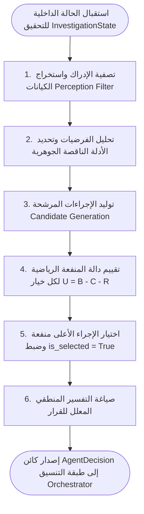

# TraceMind — وثيقة تصميم الوكيل الذكي (Intelligent Agent Architecture)

[العودة إلى المعمارية الرئيسية (Main Architecture)](ARCHITECTURE.md)

---

## 1. فلسفة وطبيعة الوكيل الذكي (Agent Paradigm)

يعتمد مشروع **TraceMind** على تصميم **وكيل ذكي هادف قائم على المنفعة (Goal-Based & Utility-Based Agent)**. يتميز هذا الوكيل عن المحركات البسيطة (Rule-Based Alerts) بما يلي:
- يمتلك **حالة داخلية تراكمية (`Internal State`)** تعكس الفرضيات المفتوحة، الأدلة المستكشفة، والمعلومات المجهولة.
- لا يتخذ قرارات متسرعة بناءً على مؤشر وحيد، بل يوازن بين خيارات استقصائية متعددة ويحسب **المنفعة الصافية المتوقعة لكل إجراء**.
- مفصول تماماً عن تنفيذ الإجراءات؛ حيث يصدر قراره المفسر (`AgentDecision`) متضمناً الإجراء الفائز (`is_selected = True`)، وتتولى طبقة التنسيق ومحاكي الإجراءات تنفيذه وإرجاع `ActionExecutionResponse`.
- يقبل **التغذية الراجعة (`Feedback`)** والسجلات الجديدة الناتجة عن المحاكاة بعد تمريرها بخط الاستيعاب والارتباط.
- يقدم **تعليلاً مفسراً وشفافاً (`Explainable Decisions`)** يربط كل اختيار بالأدلة الحسابية والسياقية.

---

## 2. تأطير الوكيل وفق نموذج PEAS

| العنصر | التوصيف الفني في TraceMind |
| :--- | :--- |
| **Performance Measure (مقياس الأداء)** | - نسبة حسم الفرضيات الصحيحة مقارنة بالسيناريو المرجعي. - تقليل الخطوات التحقيقية الزائدة والتكاليف الحسابية. - تفادي التصعيد الخاطئ (False Escalation Avoidance). - نسبة القرارات المفسرة والمدعومة بأدلة قابلة للتتبع (100%). |
| **Environment (البيئة)** | بيئة محاكاة رقمية آمنة (Simulated SOC Sandbox) تزود الوكيل بسجلات تدقيق أمنية بتنسيقات CSV و JSON ذات معلومات ناقصة وموزعة. |
| **Actuators (المُشغلات/الإجراءات)** | إجراءات استقصائية آمنة ومحاكاة تماماً يختارها الوكيل وتنفذها طبقة المحاكاة: - `REQUEST_ADDITIONAL_LOGS` - `ANALYZE_RELATED_EVENT` - `INVESTIGATE_ENTITY` - `REVIEW_EVIDENCE_RELATION` - `ESCALATE_FOR_HUMAN_REVIEW` - `CONCLUDE_INVESTIGATION` |
| **Sensors (المستشعرات)** | محركات استيعاب السجلات وتطبيعها (Ingestion Pipeline) التي تحول السجلات الخام وحمولات `RawLogPayload` إلى مصفوفة إدراك نمطية من كائنات `SecurityEvent`. |

---

## 3. حلقة اتخاذ القرار الوكيلاتي (Agent Decision Cycle)

تم تصميم حلقة الوكيل بحيث تكون **عملية استدلال نقية (Pure Reasoning Loop)** مفصولة عن التنفيذ الفعلي:

---

## 4. توليد الإجراءات المرشحة (Candidate Action Generation)

تولد النواة قائمة الإجراءات المرشحة وفق القواعد السياقية التالية:

| نوع الإجراء (`ActionType`) | شرط التوليد السياقي | المعايير المرفقة |
| :--- | :--- | :--- |
| `REQUEST_ADDITIONAL_LOGS` | وجود عناصر في قائمة `missing_information` لفرضية نشطة. | `target_entity` = الجهاز أو الحساب المطلوب جلبه |
| `ANALYZE_RELATED_EVENT` | وجود عقد في رسم الأدلة ترتبط بكيان مشبوه ولم تُفحص سياقياً. | `event_id` = معرف الحدث المستهدف |
| `INVESTIGATE_ENTITY` | ظهور حساب أو جهاز أو IP بتكرار غير معتاد مع قلة الأدلة حوله. | `target_entity` = الكيان |
| `REVIEW_EVIDENCE_RELATION` | وجود أدلة متعارضة أو تناقض زمني في مسار الحركة الجانبية. | `hypothesis_id` = الفرضية المتأثرة بالتعارض |
| `ESCALATE_FOR_HUMAN_REVIEW` | بلوغ ثقة فرضية ما حداً مرتفعاً ($\ge 0.75$) مع استمرار نقص أدلة حاسمة. | `reason` = ملخص أسباب التصعيد البشري |
| `CONCLUDE_INVESTIGATION` | حسم كافة الفرضيات (`CONFIRMED` أو `REJECTED`)، أو بلوغ الحد الأقصى للخطوات. | `outcome` = النتيجة النهائية للتحقيق |

---

## 5. الصياغة الرياضية لدالة المنفعة: $U(a) = B(a) - C(a) - R(a)$

تحسب المنفعة الصافية لكل إجراء مرشح وفق المعادلة:
$$U(a) = B(a) - C(a) - R(a)$$

### 5.1 حساب الفائدة المتوقعة $B(a)$ (Expected Benefit)
تمثل القيمة المعرفية والمعلوماتية المكتسبة من الإجراء:
$$B(a) = w_{ig} \cdot \text{InfoGain}(a) + w_{hu} \cdot \text{HypoUtility}(a) + w_{me} \cdot \text{MissingCoverage}(a)$$

- $\text{InfoGain}(a) \in [0, 1]$: مقدار تقليل عدم اليقين (مرتفع جداً لـ `REQUEST_ADDITIONAL_LOGS` عند وجود نقص حاد).
- $\text{HypoUtility}(a) \in [0, 1]$: مدى ارتباط الإجراء بفرضيات ذات مستوى خطورة أو ثقة مرتفعة.
- $\text{MissingCoverage}(a) \in [0, 1]$: نسبة الأدلة المفقودة التي يستطيع هذا الإجراء توفيرها.

### 5.2 حساب التكلفة التقديرية $C(a)$ (Estimated Cost)
تمثل العبء الحسابي وزمن انتظار جلب البيانات:
$$C(a) = w_{rp} \cdot \text{RecordsCost}(a) + w_{tm} \cdot \text{TimeCost}(a)$$

- $\text{RecordsCost}(a) \in [0, 1]$: الحجم المقدر للسجلات المسترجعة مقسوماً على حد أقصى معياري ($N / 1000$).
- $\text{TimeCost}(a) \in [0, 1]$: التعقيد الزمني التقديري لمعالجة وتطبيع البيانات الجديدة.

### 5.3 حساب المخاطرة التقديرية $R(a)$ (Estimated Risk)
تمثل مخاطر التصعيد غير المبرر أو الاعتماد على أدلة مهتزة:
$$R(a) = w_{fe} \cdot \text{FalseEscalationRisk}(a) + w_{ew} \cdot \text{EvidenceWeakness}(a)$$

- $\text{FalseEscalationRisk}(a) \in [0, 1]$: مرتفع جداً لإجراء `ESCALATE_FOR_HUMAN_REVIEW` إذا كانت ثقة الفرضية ما زالت منخفضة ($< 0.60$).
- $\text{EvidenceWeakness}(a) \in [0, 1]$: جزاء اتخاذ إجراء حاسم استناداً إلى أدلة ذات موثوقية متدنية.

### 5.4 مصفوفة الأوزان التقديرية القابلة للضبط (Tunable Provisional Weights)

> **ملاحظة منهجية:** هذه الأوزان تقديرية استدلالية أولية (Provisional Heuristic Weights) تُعاير وتُختبر عبر السيناريوهات المرجعية الثلاثة، وتُعرّف في ملف إعدادات مركزي `config.py`:

| المعامل | القيمة المبدئية | الدلالة الفنية |
| :---: | :---: | :--- |
| $w_{ig}$ | `0.40` | وزن المكسب المعلوماتي وتقليل عدم اليقين |
| $w_{hu}$ | `0.35` | وزن الصلة بالفرضيات النشطة |
| $w_{me}$ | `0.25` | وزن تغطية الأدلة المفقودة |
| $w_{rp}$ | `0.50` | وزن عبء عدد السجلات المعالجة |
| $w_{tm}$ | `0.50` | وزن زمن الانتظار والتعقيد الزمني |
| $w_{fe}$ | `0.60` | وزن عقوبة التصعيد الخاطئ (مخاطرة تشغيلية عالية) |
| $w_{ew}$ | `0.40` | وزن عقوبة ضعف موثوقية الأدلة |

---

## 6. توليد التفسير والتعليل الشفاف (Decision Explainability)

يقوم كائن `DecisionExplainer` بتوليد صياغة نصية مدعومة بالأرقام والأدلة لكل قرار يتخذه الوكيل:

### قوالب التعليل النموذجية:
1. **في حالة طلب سجلات (`REQUEST_ADDITIONAL_LOGS`):**
   > *"قرر الوكيل طلب سجلات إضافية للجهاز `{target_entity}` لمعالجة النقص في معلومات الفرضية `{hypothesis}`. حقق هذا الإجراء أعلى منفعة صافية $U = {utility:.2f}$ (فائدة: ${benefit:.2f}$، تكلفة: ${cost:.2f}$، مخاطرة: ${risk:.2f}$) نظراً لكونه السبيل الوحيد لسد ثغرة الأدلة الناقصة."*
2. **في حالة التصعيد للمراجعة البشرية (`ESCALATE_FOR_HUMAN_REVIEW`):**
   > *"بلغت الفرضية `{hypothesis}` درجة ثقة استدلالية مرتفعة قدرها `{confidence:.0%}` استناداً إلى `{supp_count}` أدلة مؤيدة، مع تعذر التأكيد القطعي تلقائياً لوجود أدلة ميدانية تحتاج تقييماً بشرياً. المنفعة المحسوبة للتصعيد $U = {utility:.2f}$ فاقت بدائل الاستقصاء الإضافي."*
3. **في حالة إنهاء التحقيق (`CONCLUDE_INVESTIGATION`):**
   > *"تم إنهاء التحقيق بنجاح بعد استيفاء {step_count} خطوات؛ حيث استقرت كافة الفرضيات عند حالات نهائية (تم دحض فرضيات النشاط غير المصرح به بنسبة ثقة متدنية `{confidence:.0%}`). المنفعة لأي إجراء إضافي أصبحت مساوية للصفر."*

---

## 7. شروط التوقف ومنع التأكيد المبكر (Stopping Conditions)

يتوقف الوكيل عن توليد خطوات جديدة عند تحقق أحد الشروط الحتمية التالية:
1. **حسم كافة الفرضيات:** وصول جميع الفرضيات إما إلى حالة `CONFIRMED` أو `REJECTED`.
2. **التصعيد البشري المعتمد:** اختيار وتنفيذ إجراء `ESCALATE_FOR_HUMAN_REVIEW` وتجميد التحقيق لحين استلام مراجعة المحلل.
3. **استنفاد سقف الخطوات (Safety Step Limit):** بلوغ الحد الأقصى للخطوات المحددة في الإعدادات (`max_investigation_steps = 20`) منعاً للحلقات اللانهائية.
4. **انعدام المنفعة الصافية:** عندما تكون أقصى منفعة لجميع الإجراءات البديلة سالبة أو مساوية للصفر ($U(a) \le 0.0$).

[العودة إلى المعمارية الرئيسية (Main Architecture)](ARCHITECTURE.md)
