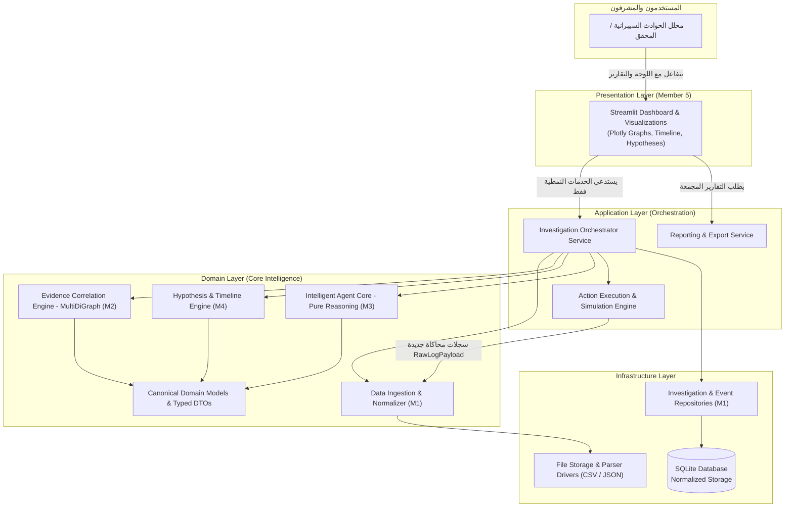
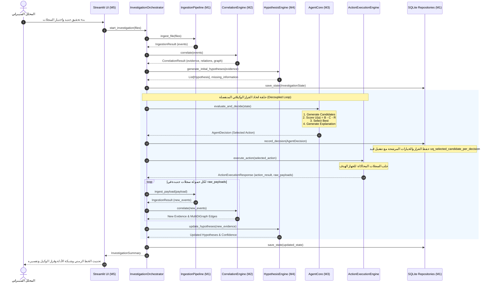
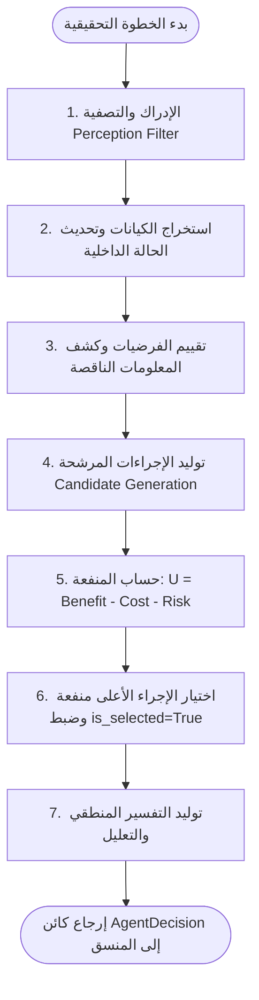
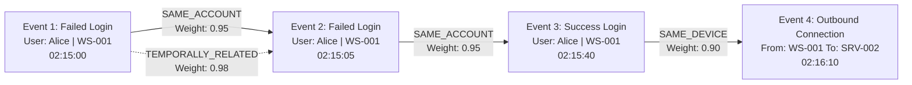
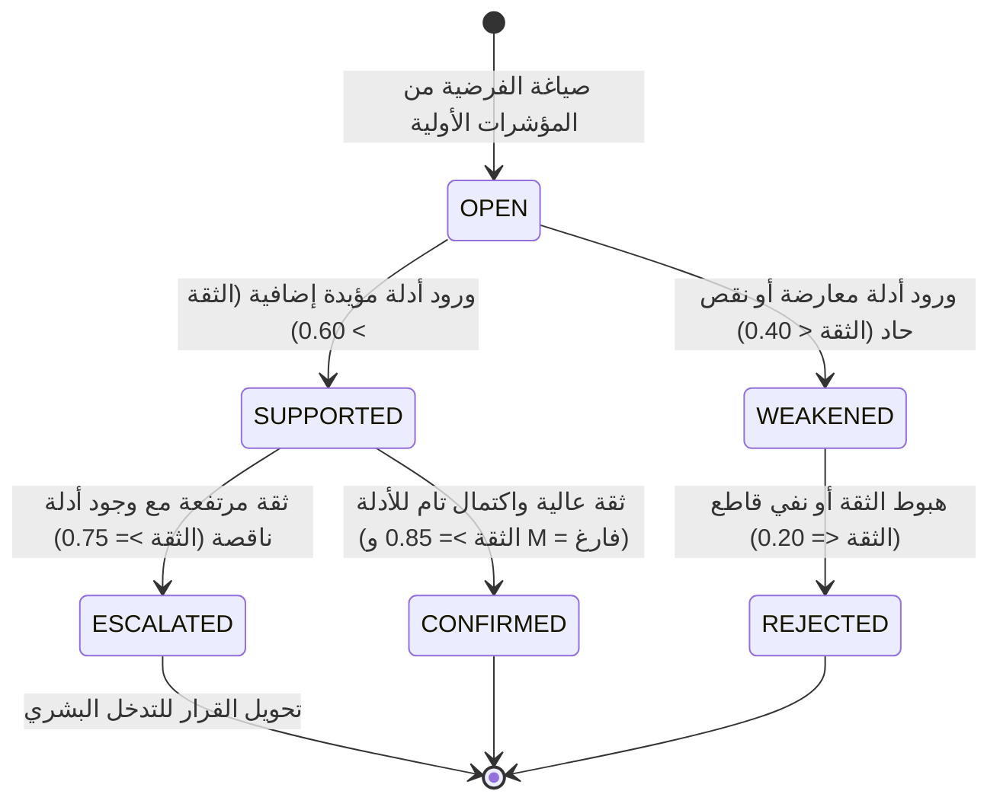
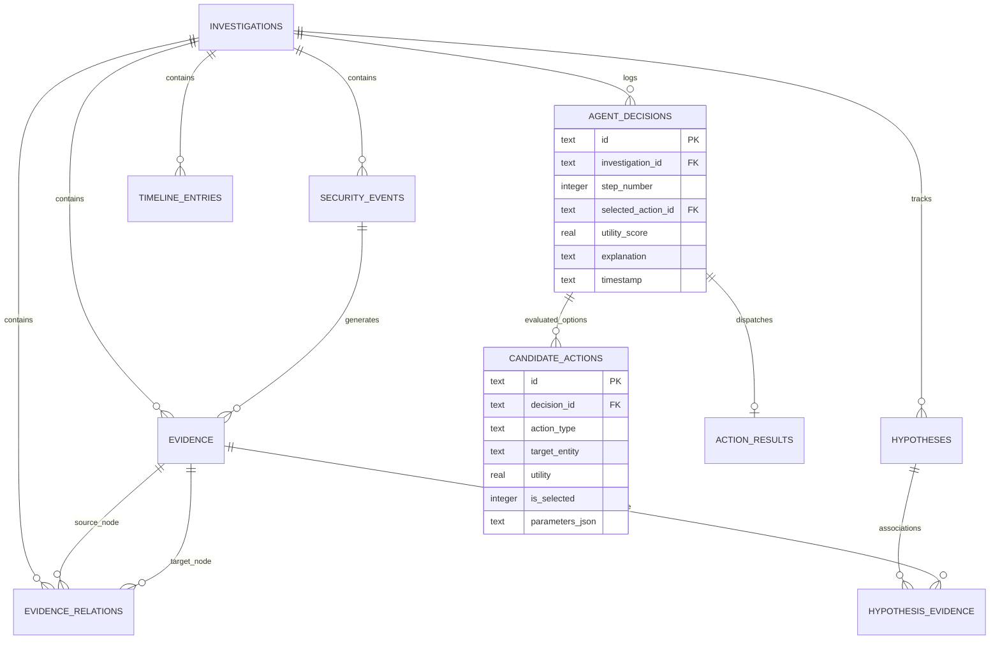
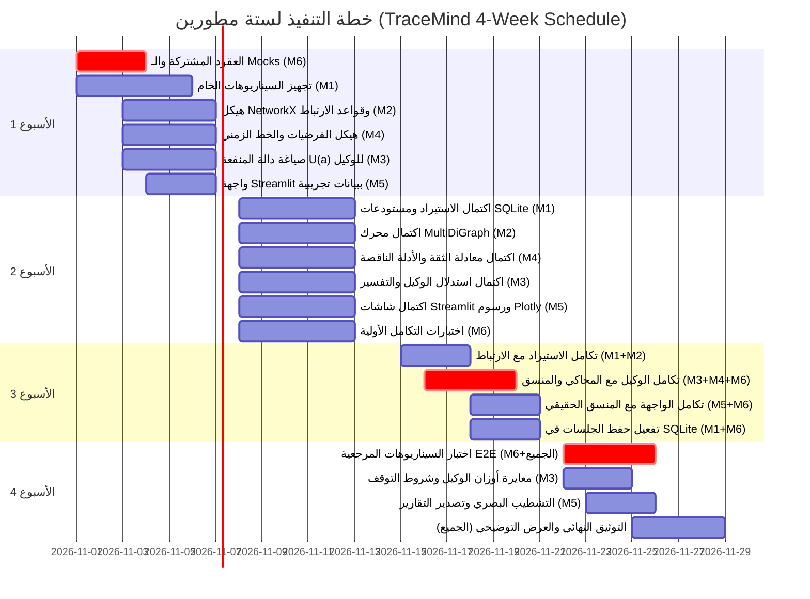
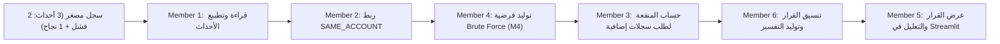

# TraceMind — الوثيقة المعمارية والتصميمية الشاملة (System Architecture Specification)

---

## جدول المحتويات (Table of Contents)
- [1. نظرة عامة ومتطلبات المشروع (Overview & Requirements)](#1-نظرة-عامة-ومتطلبات-المشروع-overview--requirements)
- [2. النمط المعماري ومبرراته (Architecture Style & Rationale)](#2-النمط-المعماري-ومبرراته-architecture-style--rationale)
- [3. مخطط سياق النظام (System Context Diagram)](#3-مخطط-سياق-النظام-system-context-diagram)
- [4. معمارية المكونات والحدود المصححة (Component Architecture)](#4-معمارية-المكونات-والحدود-المصححة-component-architecture)
- [5. تدفق البيانات ومخطط التسلسل (Data Flow & Sequence Diagram)](#5-تدفق-البيانات-ومخطط-التسلسل-data-flow--sequence-diagram)
- [6. النماذج المجالية وعقود الخدمات النمطية (Domain Models & Service Contracts)](#6-النماذج-المجالية-وعقود-الخدمات-النمطية-domain-models--service-contracts)
- [7. حلقة اتخاذ القرار للوكيل الذكي (Intelligent Agent Decision Loop)](#7-حلقة-اتخاذ-القرار-للوكيل-الذكي-intelligent-agent-decision-loop)
- [8. معمارية ربط الأدلة وشبكة NetworkX (Evidence Correlation Architecture)](#8-معمارية-ربط-الأدلة-وشبكة-networkx-evidence-correlation-architecture)
- [9. تصميم الفرضيات والخط الزمني (Hypothesis & Timeline Design)](#9-تصميم-الفرضيات-والخط-الزمني-hypothesis--timeline-design)
- [10. تصميم قاعدة بيانات SQLite ومخطط ERD (SQLite Database Design)](#10-تصميم-قاعدة-بيانات-sqlite-ومخطط-erd-sqlite-database-design)
- [11. هيكل المستودع المقترح (Proposed Repository Structure)](#11-هيكل-المستودع-المقترح-proposed-repository-structure)
- [12. نموذج الملكية وتوزيع المسؤوليات للمطورين الستة (Team Ownership Model)](#12-نموذج-الملكية-وتوزيع-المسؤوليات-للمطورين-الستة-team-ownership-model)
- [13. استراتيجية التطوير المتوازي (Parallel Development Strategy)](#13-استراتيجية-التطوير-المتوازي-parallel-development-strategy)
- [14. معمارية وهرم الاختبارات (Testing & Evaluation Architecture)](#14-معمارية-وهرم-الاختبارات-testing--evaluation-architecture)
- [15. الخطة التنفيذية لـ 4 أسابيع (Four-Week Implementation Roadmap)](#15-الخطة-التنفيذية-لـ-4-أسابيع-four-week-implementation-roadmap)
- [16. حدود المنتج الأولي والشريحة الأولى (MVP Boundaries & First Vertical Slice)](#16-حدود-المنتج-الأولي-والشريحة-الأولى-mvp-boundaries--first-vertical-slice)
- [17. القرارات المعمارية والمخاطر المتبقية (ADRs & Risk Management)](#17-القرارات-المعمارية-والمخاطر-المتبقية-adrs--risk-management)

---

## 1. نظرة عامة ومتطلبات المشروع (Overview & Requirements)

### 1.1 سياق النظام
مشروع **TraceMind** هو نظام ذكي تفاعلي لإدارة وتحليل التحقيقات في الحوادث السيبرانية (Intelligent Cyber Incident Investigator). صُمم النظام لمقرر **Intelligent Agents** الجامعي، بهدف إثبات السلوك الوكيلاتي الذكي القائم على الأهداف والمنفعة:
$$\text{Perception} \to \text{Internal State} \to \text{Reasoning} \to \text{Planning} \to \text{Action} \to \text{Feedback}$$

النظام لا يعمل كمجرد محرك تنبيهات ثابت (Rule-Based Alerts)، بل يمتلك **حالة داخلية تراكمية** للتحقيق، ويوازن بين **فرضيات متعددة متنافسة**، ويحسب القيمة المعلوماتية لجمع البيانات الناقصة عبر دالة منفعة رياضية صريحة:
$$U(a) = B(a) - C(a) - R(a)$$

### 1.2 مصفوفة المتطلبات الأساسية
| الرقم | المعيار | التوصيف الفني | المكون المسؤول |
| :---: | :--- | :--- | :---: |
| **FR-01** | استيعاب السجلات | قراءة ملفات CSV و JSON، واستيعاب كائنات `RawLogPayload` المحاكاة، والتحقق من الحقول الإلزامية وعزل السجلات التالفة والتكرارات. | Ingestion (M1) |
| **FR-02** | ربط الأدلة | استخراج الروابط السياقية (الحساب، الجهاز، الوقت، المؤشرات) دون ادعاء السببية عبر `nx.MultiDiGraph`. | Correlation (M2) |
| **FR-03** | إدارة الفرضيات | تتبع دورة حياة الفرضية وحساب درجة ثقة استدلالية وتحديد الأدلة الناقصة. | Hypotheses (M4) |
| **FR-04** | استدلال الوكيل | تقييم الإجراءات بدالة المنفعة $U(a)$، واختيار القرار الأمثل، وتوليد تعليل شفاف دون تنفيذ مباشر. | Agent Core (M3) |
| **FR-05** | محاكاة الإجراءات | تنفيذ آمن ومحاكى للإجراءات الاستقصائية (Sandbox) وإرجاع `ActionExecutionResponse` محتوياً على سجلات خام جديدة. | Orchestration (App Layer) |
| **FR-06** | الخط الزمني | إعادة بناء التسلسل الزمني الكرونولوجي الموحد للأحداث والأدلة والقرارات. | Timeline (M4) |
| **FR-07** | واجهة المستخدم | لوحة تحكم تفاعلية عبر Streamlit و Plotly مستهلكة للخدمات دون احتواء أي منطق عمل. | UI & Reporting (M5) |
| **NFR-01**| الأمان المطلق | بيئة محاكاة محلية 100%، بدون صلاحيات تنفيذ على أنظمة حقيقية أو استدعاءات LLM خارجية. | System-wide |

---

## 2. النمط المعماري ومبرراته (Architecture Style & Rationale)

تم اعتماد نمط **Modular Monolith (الكتلي المعياري)** ذي الطبقات الصريحة المستندة إلى الحدود المجالية (Domain-Driven Boundaries).

```
+-----------------------------------------------------------------+
|                   Presentation Layer (Streamlit)                |
+-----------------------------------------------------------------+
                                |  (Consumes Typed DTOs only)
                                v
+-----------------------------------------------------------------+
|            Application Layer (Orchestrator & Simulation)        |
+-----------------------------------------------------------------+
          |                     |                      |
          v                     v                      v
+------------------+  +-------------------+  +--------------------+
| Ingestion & Repo |  | Correlation Graph |  | Hypothesis/Timeline|
|   (Member 1)     |  |   (Member 2)      |  |    (Member 4)      |
+------------------+  +-------------------+  +--------------------+
          \                     |                      /
           \                    v                     /
            +---------------------------------------+
            |      Intelligent Agent Core (M3)      |
            +---------------------------------------+
                                |
                                v
+-----------------------------------------------------------------+
|             Domain Layer (Shared Models & Contracts)            |
+-----------------------------------------------------------------+
                                |
                                v
+-----------------------------------------------------------------+
|              Infrastructure Layer (SQLite & File IO)            |
+-----------------------------------------------------------------+
```

### أسباب ترجيح Modular Monolith:
1. **التحكم والسرعة:** يتطلب مشروع التخرج إنجازاً خلال 4 أسابيع؛ المعمارية المعيارية تلغي أي تعقيدات شبكية أو تزامن موزع (Distributed Systems Overhead).
2. **عزل التضارب بين المطورين الستة:** عبر عزل كل عضو داخل حزمة برمجية مستقلة تتخاطب مع الحزم الأخرى فقط عبر عقود برمجية نمطية (`Protocols`).
3. **سهولة ونقاء الاختبار:** إمكانية اختبار كل وحدة كود معزولة (Unit Testing) بنسبة 100% دون الحاجة لتشغيل واجهة Streamlit أو قاعدة بيانات SQLite.

---

## 3. مخطط سياق النظام (System Context Diagram)

يوضح المخطط التالي كيفية تفاعل المستخدم مع النظام وحدود تدفق العمليات:



---

## 4. معمارية المكونات والحدود المصححة (Component Architecture)

بناءً على نتائج التدقيق المعماري، تم فك الارتباط بين اتخاذ القرار وتنفيذه:

```mermaid
flowchart LR
    subgraph Ingestion_Box ["1. استيعاب البيانات (M1)"]
        Parser["CSV / JSON / Payload Parsers"]
        Normalizer["Event Normalizer"]
        Deduplicator["Deduplication Engine"]
        Repos["SQLite Repositories"]
    end

    subgraph Correlation_Box ["2. ربط الأدلة (M2)"]
        Rules["Correlation Rules Engine"]
        MultiGraph["NetworkX MultiDiGraph"]
    end

    subgraph Hypo_Box ["4. الفرضيات والخط الزمني (M4)"]
        HypoTracker["Hypothesis Engine & Missing Info"]
        TimelineGen["Timeline Reconstructor"]
    end

    subgraph Agent_Box ["3. الوكيل الذكي (M3)"]
        Perception["Perception Filter"]
        UtilityCalc["Utility Engine U(a)"]
        Explainer["Decision Explainer"]
    end

    subgraph App_Box ["Application Layer"]
        Orchestrator["Investigation Orchestrator"]
        SimRunner["Action Simulation Runner"]
    end

    Ingestion_Box -->|SecurityEvents موحدة| Correlation_Box
    Correlation_Box -->|Evidence & Relations| Hypo_Box
    Hypo_Box -->|State & Missing Info| Orchestrator
    Orchestrator -->|Current State| Agent_Box
    Agent_Box -->|AgentDecision فقط| Orchestrator
    Orchestrator -->|Selected Action| SimRunner
    SimRunner -->|ActionExecutionResponse\n(RawLogPayloads)| Ingestion_Box
```

---

## 5. تدفق البيانات ومخطط التسلسل (Data Flow & Sequence Diagram)

يوضح مخطط التسلسل التالي دورة حياة التحقيق الشاملة، مع التركيز على فصل الوكيل عن التنفيذ وعودة الحمولات الخام الناتجة عن المحاكاة:



---

## 6. النماذج المجالية وعقود الخدمات النمطية (Domain Models & Service Contracts)

تفاصيل النماذج المجالية والعقود الصارمة موثقة بالكامل في الوثيقة التفصيلية:
👉 [انتقل إلى وثيقة النماذج المجالية التفصيلية (DOMAIN_MODEL.md)](DOMAIN_MODEL.md)

### ملخص الكيانات الأساسية:
- **`SecurityEvent`:** حدث أمني موحد ومطهر مع إسناد لحالة التحقق (`ValidationStatus`).
- **`Evidence`:** دليل مستخلص ذو درجة موثوقية (`reliability`) ومصدر معتمد.
- **`EvidenceRelation`:** علاقة سياقية موجهة تمثل حافة في رسم الأدلة.
- **`Hypothesis`:** فرضية تحقيق تحمل درجة ثقة استدلالية وسجل الانتقالات.
- **`CandidateAction`:** إجراء استقصائي مرشح يحمل تقديرات المنفعة والتكلفة والمخاطر وعلامة `is_selected`.
- **`AgentDecision`:** قرار الوكيل المعتمد مقروناً بالتفسير ومصفوفة الخيارات البديلة.
- **`RawLogPayload`:** كائن DTO يمثل حمولة سجلات خام ناتجة عن المحاكاة.
- **`ActionExecutionResponse`:** كائن DTO يجمع بين نتيجة التنفيذ الوصفية وحمولات السجلات الجديدة.

---

## 7. حلقة اتخاذ القرار للوكيل الذكي (Intelligent Agent Decision Loop)

تفاصيل تصميم الوكيل الذكي ودالة المنفعة وتوليد التفسيرات موثقة في:
👉 [انتقل إلى وثيقة تصميم الوكيل الذكي (AGENT_DESIGN.md)](AGENT_DESIGN.md)



---

## 8. معمارية ربط الأدلة وشبكة NetworkX (Evidence Correlation Architecture)

### 8.1 حسم نوع الرسم: `nx.MultiDiGraph`
تم اعتماد **`nx.MultiDiGraph`** لحل التعارض عند وجود أكثر من علاقة ارتباط بين نفس زوج العقد (مثل: تطابق الحساب + التقارب الزمني الشديد).
- كل حافة تحمل معرّفاً مستقلاً وسمات محددة: `relation_type`, `weight`, `confidence`, `temporal_delta`.
- تمكين التحليل الرياضي لمسارات الهجوم وعزل المجموعات المتصلة (`Connected Components`).
- التصدير الدقيق لـ Plotly عبر كائن نمطي `GraphVisualData`.



---

## 9. تصميم الفرضيات والخط الزمني (Hypothesis & Timeline Design)

### 9.1 معادلة الثقة الاستدلالية (Heuristic Confidence Function)
تُحسب درجة الثقة بطريقة حتمية خاضعة للمعادلة التالية:
$$\text{Confidence}(H) = \text{Clamp}_{[0, 1]} \left( \frac{\sum_{e \in S} \text{Rel}(e)}{\max(|S|, 1)} - \lambda_c \sum_{e \in C} \text{Rel}(e) - \lambda_m |M| \right)$$

حيث:
- $S$: الأدلة المؤيدة (Supporting Evidence).
- $C$: الأدلة المعارضة (Contradicting Evidence).
- $M$: الأدلة الناقصة الجوهرية (Missing Evidence Types).
- $\text{Rel}(e)$: موثوقية الدليل (Reliability).
- $\lambda_c = 0.5$: معامل عقوبة الدليل المعارض.
- $\lambda_m = 0.05$: معامل خفض الثقة لكل معلومة ناقصة.

### 9.2 دورة حياة الفرضية


---

## 10. تصميم قاعدة بيانات SQLite ومخطط ERD (SQLite Database Design)

تفاصيل مخطط قاعدة البيانات وجداول الربط والـ DDL الكامل موثقة في:
👉 [انتقل إلى وثيقة قاعدة البيانات التفصيلية (DATA_MODEL.md)](DATA_MODEL.md)

### 10.1 ضمان الاتساق المرجعي بين القرارات والخيارات المرشحة
- جدول `agent_decisions` يحمل `selected_action_id` ويشير إلى `candidate_actions(id)` عبر `DEFERRABLE INITIALLY DEFERRED`.
- جدول `candidate_actions` يحمل `decision_id` (`ON DELETE CASCADE`) وعمود `is_selected INTEGER NOT NULL DEFAULT 0`.
- يتم فرض عدم اختيار أكثر من خيار مرشح لنفس القرار حتمياً في محرك SQLite عبر:
  ```sql
  CREATE UNIQUE INDEX uq_selected_candidate_per_decision 
  ON candidate_actions(decision_id) WHERE is_selected = 1;
  ```



---

## 11. هيكل المستودع المقترح (Proposed Repository Structure)

```text
tracemind/
│
├── app/
│   ├── domain/                  # [Member 6 Lead] النماذج الموحدة والعقود الصارمة
│   │   ├── __init__.py
│   │   ├── models.py            # SecurityEvent, Evidence, Hypothesis, DTOs
│   │   └── contracts.py         # Interfaces / Protocols
│   │
│   ├── application/             # [Member 6 + M5] طبقة التنسيق والمحاكاة
│   │   ├── __init__.py
│   │   ├── orchestrator.py      # منسق سير التحقيق الشامل
│   │   ├── action_executor.py   # محاكي تنفيذ الإجراءات
│   │   └── report_service.py    # خدمة توليد التقارير
│   │
│   ├── infrastructure/          # [Member 1 + M6] قاعدة البيانات ومستودعات التخزين
│   │   ├── __init__.py
│   │   ├── database.py          # اتصال SQLite و DDL Schema
│   │   ├── repositories.py      # دوال التخزين والاسترجاع (CRUD)
│   │   └── config.py            # الأوزان والمعايير القابلة للضبط
│   │
│   ├── ingestion/               # [Member 1] استيراد وتنظيف وتطبيع السجلات
│   │   ├── __init__.py
│   │   ├── csv_parser.py
│   │   ├── json_parser.py
│   │   ├── normalizer.py
│   │   └── deduplicator.py
│   │
│   ├── correlation/             # [Member 2] محرك الارتباط وشبكة MultiDiGraph
│   │   ├── __init__.py
│   │   ├── rules.py             # قواعد الارتباط المستقلة
│   │   ├── graph_builder.py     # بناء وإدارة NetworkX MultiDiGraph
│   │   └── correlation_engine.py
│   │
│   ├── agent/                   # [Member 3] نواة الوكيل الذكي (استدلال نقي)
│   │   ├── __init__.py
│   │   ├── perception.py        # تصفية المُدركات
│   │   ├── utility_calculator.py# حساب U(a) = B - C - R
│   │   ├── action_generator.py  # توليد الإجراءات المرشحة
│   │   ├── explainer.py         # التعليل وتوليد التفسيرات
│   │   └── agent_core.py        # نواة الوكيل المستقلة
│   │
│   ├── investigation/           # [Member 4] الفرضيات والخط الزمني
│   │   ├── __init__.py
│   │   ├── hypothesis_engine.py # إدارة الفرضيات ومعادلة الثقة
│   │   └── timeline_builder.py  # بناء الخط الزمني التراكمي
│   │
│   └── ui/                      # [Member 5] واجهات Streamlit و Plotly
│       ├── __init__.py
│       └── pages/
│           ├── dashboard.py
│           ├── investigations.py
│           ├── timeline_view.py
│           ├── graph_view.py
│           ├── hypotheses_view.py
│           └── decisions_view.py
│
├── data/
│   ├── raw/                     # السجلات الخام
│   ├── normalized/              # السجلات المنظفة
│   └── scenarios/               # سيناريوهات الاختبار المرجعية (Ground Truth)
│
├── tests/                       # بنية الاختبارات لجميع المطورين
│   ├── conftest.py              # المشتركات ومولدات البيانات الوهمية (Fixtures)
│   ├── unit/                    # اختبارات الوحدات المعزولة (M1 to M5)
│   ├── integration/             # اختبارات التكامل الثنائية (M6)
│   └── e2e/                     # اختبارات السيناريوهات الشاملة (M6)
│
├── docs/                        # التوثيق المعماري الشامل
│   ├── ARCHITECTURE.md          # هذه الوثيقة
│   ├── DOMAIN_MODEL.md
│   ├── DATA_MODEL.md
│   ├── AGENT_DESIGN.md
│   ├── TEAM_WORKFLOW.md
│   ├── IMPLEMENTATION_PLAN.md
│   └── diagrams/                # ملفات الرسوم والمخططات المصدرية
│
├── requirements.txt
├── README.md
└── streamlit_app.py             # نقطة الدخول لواجهة المستخدم
```

---

## 12. نموذج الملكية وتوزيع المسؤوليات للمطورين الستة (Team Ownership Model)

تفاصيل سير العمل وقواعد الدمج وحوكمة التعديلات موثقة في:
👉 [انتقل إلى وثيقة سير عمل الفريق (TEAM_WORKFLOW.md)](TEAM_WORKFLOW.md)

| المطور | النطاق الأساسي المملوك | مسؤولية اختبارات الوحدة (Unit Tests) | المخرجات المقدمة للفريق |
| :---: | :--- | :--- | :--- |
| **Member 1** | `app/ingestion/`<br>`app/infrastructure/` | اختبارات التحليل، التطبيع، استيعاب الحمولات الخام `RawLogPayload`، ودوال مستودعات SQLite. | كائنات `SecurityEvent` ومستودعات التخزين |
| **Member 2** | `app/correlation/` | اختبارات قواعد الارتباط، دقة الحواف، وبناء `nx.MultiDiGraph`. | كائنات `Evidence`، العلاقات، وبيانات الرسم |
| **Member 3** | `app/agent/` | اختبارات استدلال الوكيل، مصفوفة التوليد، دالة المنفعة $U(a)$، والشرح. | كائن `AgentDecision` مفسر بالكامل |
| **Member 4** | `app/investigation/` | اختبارات معادلة الثقة، الفرضيات المتعارضة، وتوحيد الخط الزمني. | كائنات `Hypothesis` وسجل `TimelineEntry` |
| **Member 5** | `app/ui/`<br>`app/reporting/` | اختبارات عزل الصفحات، استهلاك الـ DTOs، وتصدير التقارير. | واجهة Streamlit ورسوم Plotly التفاعلية |
| **Member 6** | `app/domain/`<br>`app/application/`<br>`tests/` | اختبارات التكامل الشاملة (Integration & E2E) وتنسيق `ActionExecutionResponse`. | العقود المعتمدة، المنسق العام، وضمان الجودة |

---

## 13. استراتيجية التطوير المتوازي (Parallel Development Strategy)

تعتمد استراتيجية التطوير على **عزل المكونات عبر الـ Mocks المعتمدة على العقود**:
1. **في اليوم الثاني من المشروع:** يعتمد الجميع ملفات `models.py` و `contracts.py`.
2. **Member 5 (UI):** يعمل فوراً باستخدام كائن وهمي `MockInvestigationService` يُرجع بيانات DTOs مجهزة مسبقاً لرسم الشاشات ومخططات Plotly.
3. **Member 3 (Agent):** يختبر استدلال الوكيل ودالة المنفعة على حالات وهمية (`MockInvestigationState`) دون انتظار اكتمال معالجة السجلات.
4. **Member 2 (Correlation):** يختبر قواعد الارتباط باستخدام قائمة أحداث مصنعة في ملف `conftest.py`.

---

## 14. معمارية وهرم الاختبارات (Testing & Evaluation Architecture)

```
              / \
             /   \
            / E2E \       10% (3 Ground Truth Scenarios)
           /-------\
          /  Integ  \     20% (Pipeline Integration: Ingestion->Correlation->Agent)
         /-----------\
        /  Unit Tests \   70% (Isolated Unit Tests across all 6 members)
       +---------------+
```

### معايير النجاح والتقييم:
- **تغطية الكود (Test Coverage):** $\ge 80\%$ لكافة وحدات المنطق الداخلي.
- **السيناريوهات المرجعية (Ground Truth):**
  1. *سيناريو Brute Force + Lateral Movement:* التأكد من طلب سجلات الجهاز الثاني ثم التصعيد للمراجعة البشرية.
  2. *سيناريو النشاط الإداري الطبيعي:* التأكد من عدم التصعيد وإغلاق التحقيق بنجاح.
  3. *سيناريو الأدلة المتعارضة:* التأكد من خفض درجة الثقة ورفض الفرضية في حال وجود نفي قاطع.

---

## 15. الخطة التنفيذية لـ 4 أسابيع (Four-Week Implementation Roadmap)

تفاصيل المهام الأسبوعية ومعايير القبول ومسار جانت موثقة بالكامل في:
👉 [انتقل إلى وثيقة الخطة التنفيذية التفصيلية (IMPLEMENTATION_PLAN.md)](IMPLEMENTATION_PLAN.md)



---

## 16. حدود المنتج الأولي والشريحة الأولى (MVP Boundaries & First Vertical Slice)

### الشريحة الرأسية الأولى (Vertical Slice)
الهدف منها التحقق المبكر من تدفق البيانات عبر جميع الطبقات في نهاية **الأسبوع الأول / بداية الأسبوع الثاني**:



---

## 17. القرارات المعمارية والمخاطر المتبقية (ADRs & Risk Management)

### ملخص سجلات القرارات المعمارية (ADR Summary):
- **ADR-001 (Modular Monolith):** تم اعتماده لتقليص الهدر التشغيلي والتركيز على ذكاء الوكيل مع الحفاظ على التوازي عبر العقود النمطية.
- **ADR-002 (Decoupled Agent Reasoning):** تم قصر الوكيل على الاستدلال واختيار القرارات وتفويض التنفيذ والمحاكاة لطبقة التطبيق عبر استجابة نمطية `ActionExecutionResponse`.
- **ADR-003 (NetworkX MultiDiGraph):** تم اعتماده لتمثيل العلاقات المتعددة بدقة ودون دمج مشوه للحواف.
- **ADR-004 (Normalized SQLite with Candidate Selection Constraint):** اعتماد جدول ربط صريح `hypothesis_evidence`، وتوثيق البدائل في `candidate_actions` مع فرض قيد الفهرس الجزئي الفريد `uq_selected_candidate_per_decision` لمنع تعدد الخيارات المختارة للقرار الواحد.

### مصفوفة المخاطر المتبقية وإجراءات التخفيف:
| المخاطرة | الاحتمالية | الأثر | خطة التخفيف المعتمدة |
| :--- | :---: | :---: | :--- |
| **اعتبار درجة الثقة إثباتاً للاختراق** | متوسطة | عالي | النص الصريح على أن درجة الثقة هي مؤشر استدلالي (Heuristic)؛ والتأكيد يتطلب اكتمال كافة الأدلة الناقصة وانعدام الأدلة المعارضة. |
| **تعقيد تراكب الحواف في Plotly** | متوسطة | منخفض | تطبيق إزاحة بصرية للحواف المتعددة في دالة `get_visual_data` التي يطورها Member 2. |
| **تضارب تعديل العقود البرمجية** | منخفضة | عالي جداً | حظر التعديل المباشر على `app/domain/` إلا عبر آلية RFC وبإشراف مسؤول التكامل (Member 6). |
