# TraceMind — وثيقة التصميم المعماري وخطة التنفيذ (Architecture & Planning Specification)

---

## 1. Requirements Analysis (تحليل المتطلبات والافتراضات)

### 1.1 طبيعة النظام وسياق المشروع
مشروع **TraceMind** هو نظام ذكي تفاعلي لإدارة وتحليل التحقيقات في الحوادث السيبرانية (Intelligent Cyber Incident Investigator). صُمم المشروع في سياق أكاديمي لمقرر **Intelligent Agents**، بهدف إثبات السلوك الوكيلاتي الكامل (Agency) عبر دورة حياة متسلسلة تشمل:
$$\text{Perception} \to \text{Internal State} \to \text{Reasoning} \to \text{Planning} \to \text{Action} \to \text{Feedback}$$

النظام لا يعمل كأداة مراقبة تقليدية (Rule-Based SIEM) تعتمد فقط على تنبيهات جامدة مثل (`if failed_logins > 5: alert()`)، بل يمتلك **حالة داخلية تراكمية** للتحقيق، ويدير **فرضيات متعددة متنافسة**، ويحسب **منفعة جمع المعلومات الإضافية** عبر دالة منفعة واضحة:
$$U(a) = B(a) - C(a) - R(a)$$

### 1.2 المتطلبات الوظيفية الأساسية (Functional Requirements)
1. **استيعاب السجلات (Log Ingestion & Parsing):**
   - قراءة السجلات بتنسيقات CSV و JSON.
   - التحقق من سلامة البيانات واكتشاف السجلات التالفة والتكرارات (Deduplication).
   - توحيد الأحداث وفق نموذج بيانات قياسي موحد (`SecurityEvent`).
2. **ربط الأدلة (Evidence Correlation):**
   - ربط الأحداث وفق محاور: الحساب (`account_id`)، الجهاز (`device_id`)، الوقت (التقارب الزمني)، وعناوين الشبكة والمؤشرات المشتركة (`Indicators`).
   - بناء رسم بياني موجّه للأدلة (`Evidence Graph`) باستخدام مكتبة NetworkX.
   - الفصل الصارم بين الارتباط والسببية: $(\text{Correlation} \neq \text{Causation})$.
3. **إدارة الفرضيات (Hypothesis Management):**
   - صياغة فرضيات أولية متعددة (مثل: *Brute Force Attack*, *Lateral Movement*, *Normal IT Admin Activity*).
   - ربط الأدلة الداعمة (`Supporting Evidence`) والأدلة النافية/المعارضة (`Contradicting Evidence`).
   - تحديد الأدلة المفقودة (`Missing Information`) المطلوبة لحسم كل فرضية.
   - تحديث مستوى الثقة بالفرضية ديناميكياً وفق الأدلة الواردة.
4. **نواة الوكيل الذكي (Intelligent Agent Core):**
   - توليد إجراءات تحقيق مرشحة (`Candidate Actions`) مثل: طلب سجلات إضافية لجهاز معين، تحليل حدث مرتبط، التحقيق في كيان، أو تصعيد الحادث للمراجعة البشرية.
   - تقييم الإجراءات بناءً على دالة المنفعة الرياضية $U(a) = B(a) - C(a) - R(a)$.
   - تنفيذ الإجراء في بيئة محاكاة آمنة (Simulated Execution) وتلقي التغذية الراجعة.
   - توفير تفسير شفاف لكل قرار (`Decision Explainability`) يربط القرار بالأدلة والحسابات.
5. **الخط الزمني الموحد (Timeline Reconstruction):**
   - بناء تسلسل زمني دقيق يجمع: الأحداث المكتشفة، الأدلة المستنتجة، قرارات الوكيل، والتغذية الراجعة.
6. **واجهة المستخدم والتقارير (Streamlit Dashboard & Reporting):**
   - لوحة تحكم تفاعلية توفر نظرة عامة على التحقيقات، استكشاف الأحداث، رسم شبكة الأدلة (Plotly)، الخط الزمني، شجرة الفرضيات، وسجل قرارات الوكيل.
   - عزل تام لمنطق العمل: الواجهة تستهلك خدمات (`Services`) فقط ولا تتضمن قواعد منطقية داخلية.

### 1.3 المتطلبات غير الوظيفية (Non-Functional Requirements)
- **الأمان المطلق (Safety & Sandboxing):** تشغيل النظام بالكامل على بيانات محاكاة مصرح بها، وعدم تنفيذ أي إجراء هجومي أو تعديل على أنظمة إنتاجية حقيقية.
- **القابلية للاختبار (Testability):** استقلالية الوكيل ونواة المنطق عن واجهة Streamlit وقاعدة البيانات لتسهيل اختبارات Unit و Integration عبر `pytest`.
- **قابلية التوازي (Parallelizability):** بنية معمارية تمكّن 6 مطورين من العمل معاً دون تضارب في الشيفرة البرمجية.
- **الحتمية والقابلية للتكرار (Determinism & Reproducibility):** إمكانية إعادة تشغيل نفس السيناريو والحصول على نفس القرارات وحسابات المنفعة.

---

## 2. System Architecture (معمارية النظام الشاملة)

### 2.1 تقييم واختيار النمط المعماري (Architecture Style Decision)
تمت المقارنة بين ثلاثة أنماط معمارية رئيسية لاختيار الأنسب لمشروع TraceMind:

| المعيار | Pure Monolith (كتلي بسيط) | Microservices (خدمات مصغرة) | **Modular Monolith (كتلي معياري - المختار)** |
| :--- | :--- | :--- | :--- |
| **التعقيد التشغيلي** | منخفض جداً | مرتفع جداً (شبكات، حاويات، مزامنة) | **منخفض ومثالي للبيئة المحلية** |
| **سرعة التطوير** | سريعة في البداية ثم تتباطأ | بطيئة جداً بسبب الـ Overhead | **سريعة وثابتة طوال الـ 4 أسابيع** |
| **توازي عمل 6 مطورين** | ضعيف (تضاربات دمج مستمرة) | ممتاز نظرياً، معقد عملياً | **ممتاز بفضل عقود Interfaces الواضحة** |
| **سهولة الاختبار** | متوسطة (تداخل المكونات) | صعبة (تتطلب Mocking للشبكة) | **ممتازة (Mocking عبر Protocols محلية)** |
| **التبعيات التقنية** | ملفات مكدسة بدون حدود | Docker, gRPC/HTTP, Message Queues | **Python + SQLite فقط (حسب المقترح)** |
| **الملاءمة الأكاديمية** | تفتقر للتنظيم الهندسي المتقدم | مبالغ فيها وتشتت عن منطق الوكيل | **الخيار المثالي هندسياً وأكاديمياً** |

> **القرار المعماري:** اعتماد **Modular Monolith** المقسم إلى طبقات نظيفة (Layered Domain-Driven Boundaries)، حيث تعمل جميع الوحدات داخل بيئة تشغيل Python واحدة ولكن بحدود صارمة تمنع التداخل المباشر إلا عبر عقود معرّفة (`Protocols/Contracts`).

### 2.2 المخطط المعماري للنظام (System Context Diagram)

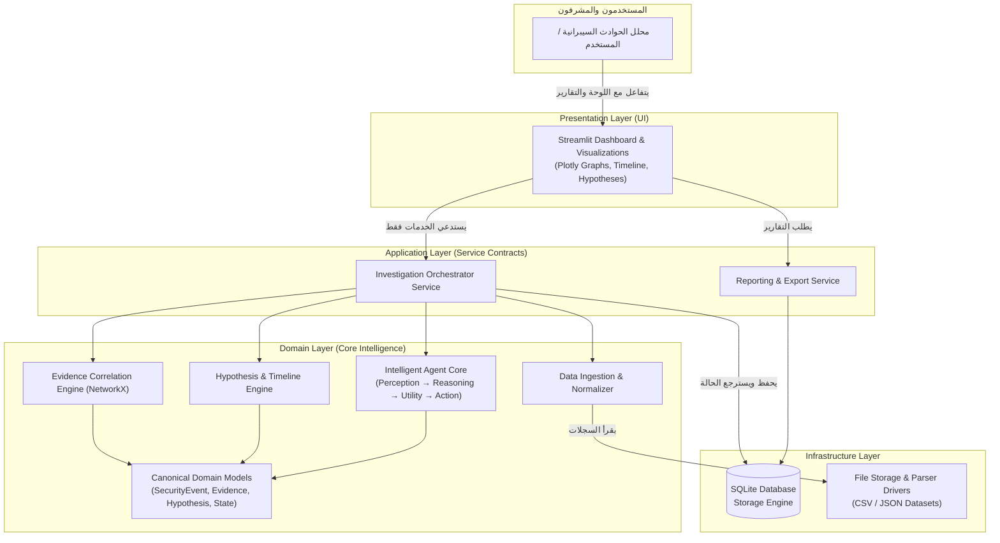

---

## 3. Component Architecture (معمارية المكونات وتدفق البيانات)

### 3.1 توصيف المكونات الرئيسية ومسؤولياتها

```mermaid
flowchart LR
    subgraph Ingestion ["1. وحدة الاستيراد"]
        CSVParser["CSV / JSON Parsers"]
        Normalizer["Event Normalizer"]
        Deduplicator["Deduplication Engine"]
    end

    subgraph Correlation ["2. محرك الارتباط"]
        Rules["Correlation Rules Engine"]
        NetXGraph["NetworkX Evidence Graph"]
    end

    subgraph Investigation ["3. محرك الفرضيات والخط الزمني"]
        HypoTracker["Hypothesis State Tracker"]
        TimelineGen["Timeline Generator"]
    end

    subgraph Agent ["4. نواة الوكيل الذكي"]
        Perception["Perception Filter"]
        UtilityCalc["Utility Engine: U(a)"]
        ActionSim["Simulated Action Runner"]
        Explainer["Decision Explainer"]
    end

    Ingestion -->|SecurityEvents موحدة| Correlation
    Correlation -->|Evidence + Relations| Investigation
    Investigation -->|State + Missing Info| Agent
    Agent -->|Simulated Action| Ingestion
    Agent -->|Decisions & Feedback| Investigation
```

### 3.2 مخطط تدفق البيانات التسلسلي (End-to-End Data Flow Sequence)

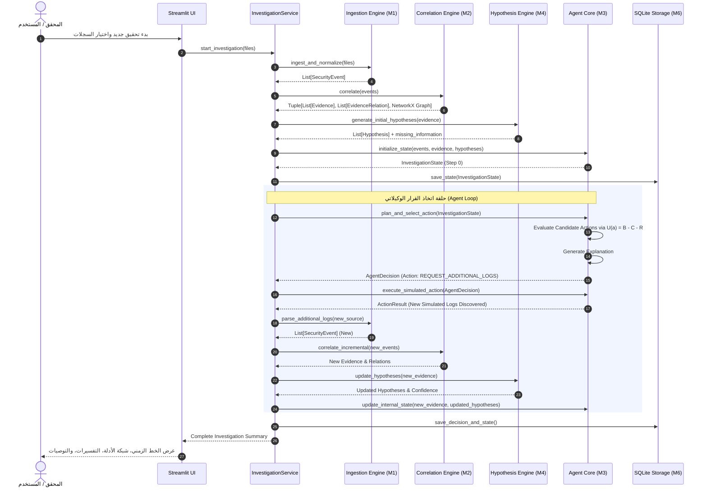

---

## 4. Domain Model (النموذج المجالي والمفاهيمي الموحد)

لضمان عدم حدوث تضارب بين المطورين الستة، يُمثّل النموذج المجالي **العقد المعياري المشترك** الذي تُبنى عليه كافة الوحدات.

### 4.1 الكيانات والمخطط المفاهيمي

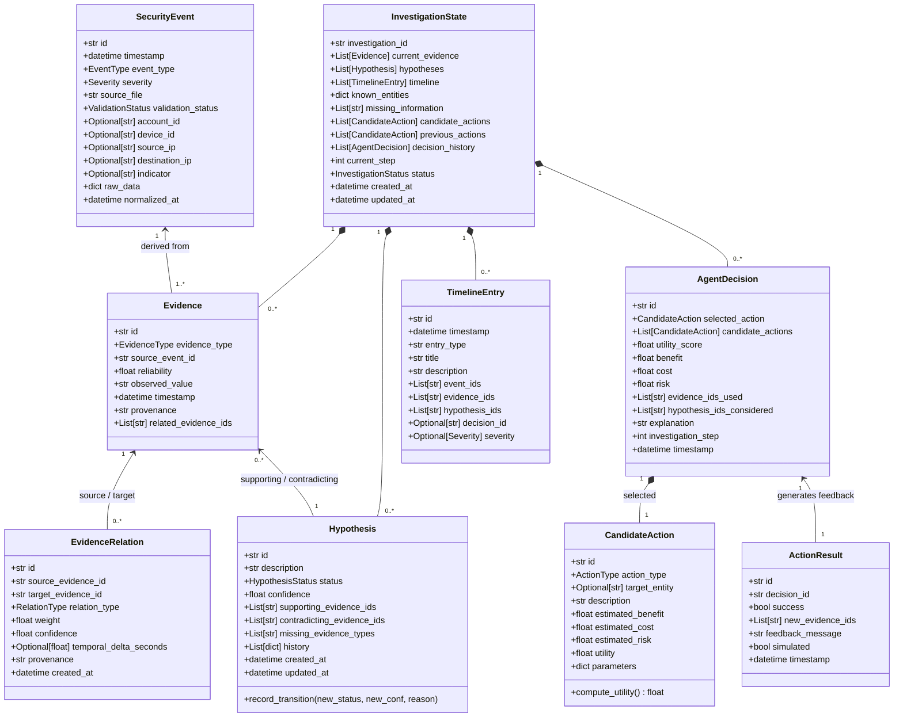

### 4.2 دورة حياة الفرضية (Hypothesis State Lifecycle)

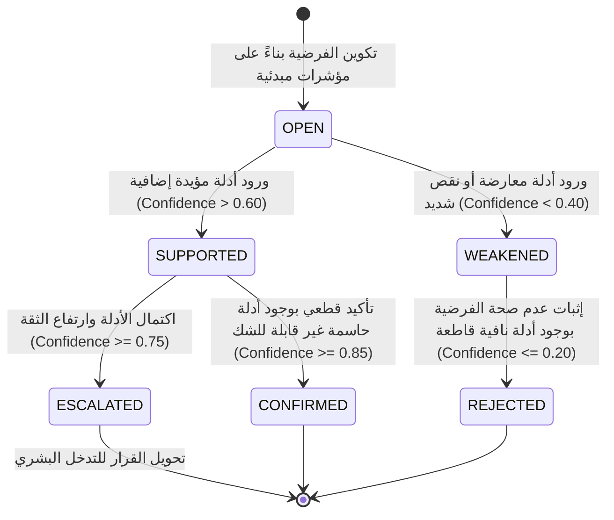

---

## 5. Data Model (مخطط قاعدة بيانات SQLite والـ ERD)

تم اختيار SQLite كقاعدة بيانات محلية تلبي المتطلبات الأكاديمية الخفيفة وتسمح بتخزين واسترجاع التحقيقات دون الحاجة لخوادم خارجية.

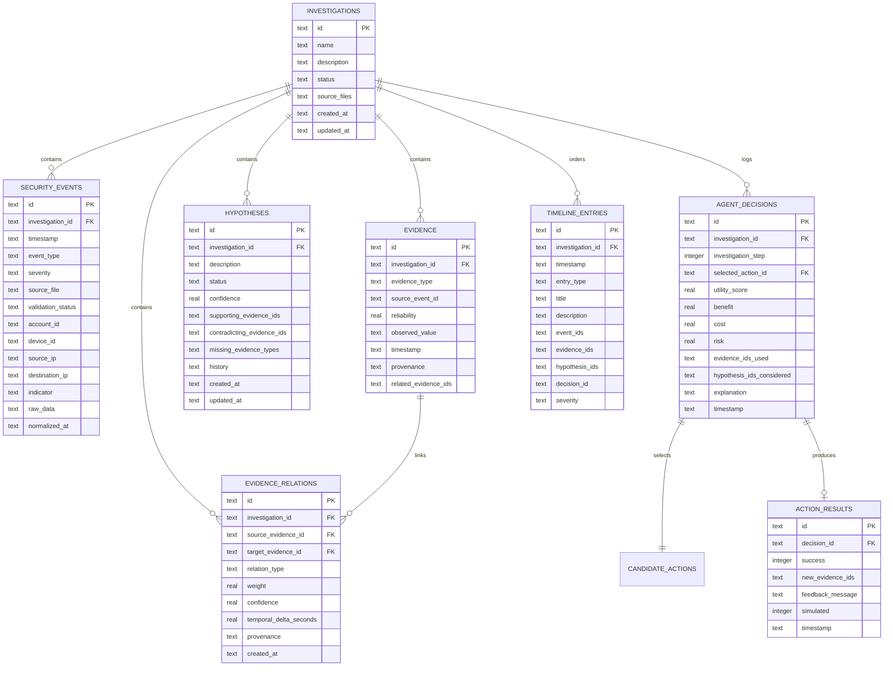

---

## 6. Intelligent Agent Architecture (تصميم الوكيل الذكي)

### 6.1 تأطير الوكيل وفق نموذج PEAS
- **Performance Measure (المقياس):** دقة حسم الفرضيات، تقليل خطوات التحقيق الزائدة، تجنب التصعيد الخاطئ (False Escalation)، وتتبع شفاف ومفسر 100% لكل قرار.
- **Environment (البيئة):** بيئة محاكاة رقمية (Simulated SOC Environment) تقرأ سجلات CSV/JSON ذات معلومات ناقصة أو غير كاملة.
- **Actuators (المُشغلات/الإجراءات):** إجراءات استقصائية آمنة (`REQUEST_ADDITIONAL_LOGS`, `ANALYZE_RELATED_EVENT`, `INVESTIGATE_ENTITY`, `REVIEW_EVIDENCE_RELATION`, `ESCALATE_FOR_HUMAN_REVIEW`, `CONCLUDE_INVESTIGATION`).
- **Sensors (المستشعرات):** محركات قراءة السجلات وتطبيعها وتغذية الأحداث الأمنية في مصفوفة الإدراك.

### 6.2 مخطط دورة اتخاذ القرار الوكيلاتي الكاملة

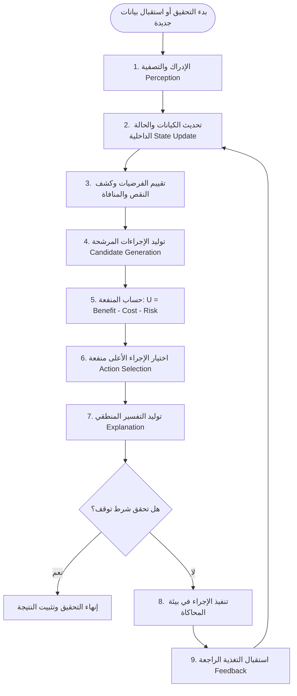

---

## 7. Evidence Correlation Architecture (معمارية محرك ربط الأدلة)

### 7.1 مبدأ "الارتباط لا يعني السببية"
يقتصر محرك الارتباط على استكشاف العلاقات الإحصائية والسياقية بين الأحداث (Contextual Proximity)، ويسجل نوع العلاقة ووزنها دون إطلاق أحكام مسبقة؛ إذ يترك الاستنتاج والترجيح لمحرك الفرضيات والوكيل الذكي.

### 7.2 مصفوفة قواعد الارتباط (Correlation Rules Matrix)

| القاعدة | الشرط المنطقي | نوع الحافة الناتجة | الوزن $W$ | درجة الثقة $C$ |
| :--- | :--- | :--- | :---: | :---: |
| **SAME_ACCOUNT** | تطابق `account_id` بين حدثين خلال نافذة زمنية $\le 1\text{ hr}$ | `SAME_ACCOUNT` | 0.90 | 0.95 |
| **SAME_DEVICE** | تطابق `device_id` بين حدثين خلال نافذة زمنية $\le 1\text{ hr}$ | `SAME_DEVICE` | 0.85 | 0.90 |
| **TEMPORAL_WINDOW** | وقوع حدثين خلال نافذة قصيرة $\le 300\text{ sec}$ | `TEMPORALLY_RELATED` | $1 - \frac{\Delta t}{300}$ | دالة متناقصة |
| **NETWORK_RELATION** | تقاطع IP المصدر والهدف بين حدثين (اتصال متبادل) | `NETWORK_RELATED` | 0.80 | 0.85 |
| **SAME_INDICATOR** | تطابق عنوان IP خارجي مشبوه أو تجزئة ملف (Hash) | `SAME_INDICATOR` | 0.95 | 0.90 |

### 7.3 تمثيل رسم الأدلة باستخدام NetworkX
يُبنى الرسم كرسم بياني موجه متعدد الخصائص `nx.DiGraph`:
- **العقد (Nodes):** تمثل الأحداث الأمنية والأدلة مع سمات: `event_type`, `severity`, `timestamp`, `reliability`.
- **الحواف (Edges):** تمثل العلاقات المستخرجة مع سمات: `relation_type`, `weight`, `confidence`, `temporal_delta`.

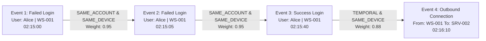

---

## 8. Hypothesis & Timeline Architecture (إدارة الفرضيات والخط الزمني)

### 8.1 حساب مستوى الثقة بالفرضية (Confidence Scoring)
يتم تحديث ثقة كل فرضية بطريقة حتمية خاضعة للمعادلة التالية:
$$\text{Confidence}(H) = \text{Clamp}_{[0, 1]} \left( \frac{\sum_{e \in S} \text{Rel}(e)}{\max(|S|, 1)} - \lambda_c \sum_{e \in C} \text{Rel}(e) - \lambda_m |M| \right)$$

حيث:
- $S$: مجموعة الأدلة الداعمة (Supporting Evidence).
- $C$: مجموعة الأدلة المعارضة (Contradicting Evidence).
- $M$: قائمة أنواع الأدلة الناقصة (Missing Evidence Types).
- $\text{Rel}(e)$: موثوقية الدليل (Reliability بين 0.0 و 1.0).
- $\lambda_c = 0.5$: معامل العقوبة للأدلة المتعارضة.
- $\lambda_m = 0.05$: معامل خفض الثقة لكل معلومة جوهرية مفقودة.

### 8.2 شروط انتقال الحالات والحماية من التأكيد المبكر
- لا تنتقل الفرضية إلى `CONFIRMED` إلا إذا كانت الثقة $\ge 0.85$ **وكانت قائمة الأدلة المفقودة فارغة تماماً** ($M = \emptyset$). هذا يمنع التأكيد المتسرع (Premature Confirmation).
- إذا كانت الثقة $\ge 0.75$ مع وجود نقص في الأدلة، تنتقل الفرضية إلى `ESCALATED` لمراجعة المحلل البشري.
- إذا هبطت الثقة إلى $\le 0.20$، تُعتبر الفرضية `REJECTED`.

---

## 9. Service/API Contracts as Design Specifications (عقود الخدمات والواجهات البرمجية)

> **ملاحظة تصميمية:** هذه الواجهات هي **مواصفات تصويرية توجيهية** (Design Specifications) تُعرّف كيف ستتخاطب المكونات لاحقاً دون كتابتها كملفات حالياً.

### 9.1 عقد خدمة التحقيق الموجهة للواجهة (Application Layer Service Contract)

```python
class IInvestigationService(Protocol):
    """الواجهة البرمجية الموحدة المتاحة لواجهة Streamlit والاختبارات"""
    
    def start_new_investigation(self, name: str, log_file_paths: list[str]) -> str:
        """تهيئة تحقيق جديد، استيراد السجلات، وتوليد الحالة الأولية"""
        ...

    def execute_next_step(self, investigation_id: str) -> dict:
        """تشغيل دورة وكيل واحدة: استدلال -> اختيار إجراء -> تنفيذ محاكى -> تحديث الحالة"""
        ...

    def run_to_completion(self, investigation_id: str, max_steps: int = 20) -> dict:
        """تشغيل التحقيق المتتابع تلقائياً حتى استيفاء شروط التوقف"""
        ...

    def get_summary_metrics(self, investigation_id: str) -> dict:
        """إرجاع إحصائيات لوحة التحكم: الفرضيات، الأدلة، مستوى الخطورة"""
        ...

    def get_graph_visual_data(self, investigation_id: str) -> dict:
        """تجهيز العقد والحواف في صيغة JSON مهيأة لرسم Plotly Network Graph"""
        ...

    def get_timeline_records(self, investigation_id: str) -> list[dict]:
        """إرجاع الخط الزمني مرتباً كرونولوجياً لعرضه في الواجهة"""
        ...
```

### 9.2 عقد وحدة الاستيراد (Member 1 Contract)

```python
class IEventIngester(Protocol):
    def ingest_and_validate(self, file_path: str) -> tuple[list[SecurityEvent], list[dict]]:
        """قراءة السجلات، تنظيفها، وفرز الأحداث الصالحة عن التالفة/المكررة"""
        ...
```

### 9.3 عقد محرك الارتباط (Member 2 Contract)

```python
class ICorrelationEngine(Protocol):
    def correlate_events(self, events: list[SecurityEvent]) -> tuple[list[Evidence], list[EvidenceRelation]]:
        """بناء علاقات الارتباط والأدلة المستخلصة دون افتراض السببية"""
        ...

    def export_networkx_graph(self) -> Any:
        """إرجاع كائن NetworkX DiGraph لاستخدامه في التحليل الرياضي والتصور"""
        ...
```

### 9.4 عقد محرك الفرضيات (Member 4 Contract)

```python
class IHypothesisEngine(Protocol):
    def evaluate(self, current_evidence: list[Evidence]) -> list[Hypothesis]:
        """صياغة وتحديث الفرضيات وتحديد الأدلة الناقصة المطلوبة"""
        ...
```

### 9.5 عقد نواة الوكيل الذكي (Member 3 Contract)

```python
class IAgentCore(Protocol):
    def evaluate_and_decide(self, state: InvestigationState) -> AgentDecision:
        """حساب دالة المنفعة U(a) لكل إجراء مرشح واختيار الأعلى منفعة وتوليد التفسير"""
        ...

    def apply_feedback(self, state: InvestigationState, result: ActionResult) -> InvestigationState:
        """تحديث الحالة الداخلية للوكيل استجابة لنتائج تنفيذ الإجراء"""
        ...
```

---

## 10. SQLite Database Design (تفاصيل قاعدة البيانات والتخزين)

### 10.1 استراتيجية الفصل بين المخزن والمحسوب ديناميكياً
- **يُخزّن في SQLite:** السجلات الأصلية المنظفة، الأدلة المستخلصة، الفرضيات المعتمدة وسجل تطورها، سجل كل قرار للوكيل (`AgentDecision`) مع التفسير والمنفعة، وسجلات الخط الزمني.
- **يُحسب ديناميكياً في الذاكرة (Runtime In-Memory):** كائن `NetworkX DiGraph` (يُبنى عند الطلب لسرعة العمليات)، ومصفوفات المسافات الزمنية المؤقتة أثناء التحليل.

### 10.2 تفاصيل الجداول ومفاتيحها وفهارسها
1. **`investigations`:**
   - الحقول: `id` (TEXT PK), `name` (TEXT), `status` (TEXT), `created_at` (TEXT), `updated_at` (TEXT).
2. **`security_events`:**
   - الحقول: `id` (TEXT PK), `investigation_id` (TEXT FK), `timestamp` (TEXT), `event_type` (TEXT), `severity` (TEXT), `account_id` (TEXT), `device_id` (TEXT), `source_ip` (TEXT), `destination_ip` (TEXT), `validation_status` (TEXT).
   - الفهارس: `idx_events_inv_time` على `(investigation_id, timestamp)`.
3. **`evidence`:**
   - الحقول: `id` (TEXT PK), `investigation_id` (TEXT FK), `evidence_type` (TEXT), `source_event_id` (TEXT), `reliability` (REAL), `observed_value` (TEXT), `timestamp` (TEXT).
4. **`evidence_relations`:**
   - الحقول: `id` (TEXT PK), `investigation_id` (TEXT FK), `source_evidence_id` (TEXT), `target_evidence_id` (TEXT), `relation_type` (TEXT), `weight` (REAL), `confidence` (REAL).
5. **`hypotheses`:**
   - الحقول: `id` (TEXT PK), `investigation_id` (TEXT FK), `description` (TEXT), `status` (TEXT), `confidence` (REAL), `missing_evidence_types` (TEXT JSON), `history` (TEXT JSON).
6. **`agent_decisions`:**
   - الحقول: `id` (TEXT PK), `investigation_id` (TEXT FK), `step` (INTEGER), `action_type` (TEXT), `utility_score` (REAL), `benefit` (REAL), `cost` (REAL), `risk` (REAL), `explanation` (TEXT), `timestamp` (TEXT).
   - الفهارس: `idx_decisions_inv` على `(investigation_id, step)`.
7. **`timeline_entries`:**
   - الحقول: `id` (TEXT PK), `investigation_id` (TEXT FK), `timestamp` (TEXT), `entry_type` (TEXT), `title` (TEXT), `description` (TEXT), `severity` (TEXT).

---

## 11. Proposed Repository Structure (هيكل المستودع المقترح)

تم تنظيم المستودع ليمنح كل مطور نطاقاً معزولاً للعمل، مع وجود مجلدات مركزية مشتركة:

```text
tracemind/
│
├── app/
│   ├── domain/                  # [ملك للجميع بإشراف M6] النماذج الموحدة والعقود الصارمة
│   │   ├── __init__.py
│   │   ├── models.py            # SecurityEvent, Evidence, Hypothesis, Decision
│   │   └── contracts.py         # Interfaces / Protocols
│   │
│   ├── application/             # [مسؤولية M6 بالتعاون مع M5] خدمات التطبيق
│   │   ├── __init__.py
│   │   ├── investigation_service.py
│   │   └── report_service.py
│   │
│   ├── infrastructure/          # [مسؤولية M1 + M6] قاعدة البيانات والإعدادات
│   │   ├── __init__.py
│   │   ├── database.py          # SQLite Manager & Connection
│   │   └── config.py            # أوزان الوكيل ومعايير النوافذ الزمنية
│   │
│   ├── ingestion/               # [مسؤولية Member 1] استيراد وتنظيف وتطبيع السجلات
│   │   ├── __init__.py
│   │   ├── csv_parser.py
│   │   ├── json_parser.py
│   │   ├── normalizer.py
│   │   └── deduplicator.py
│   │
│   ├── correlation/             # [مسؤولية Member 2] محرك الارتباط وشبكة NetworkX
│   │   ├── __init__.py
│   │   ├── rules.py             # قواعد SAME_ACCOUNT, SAME_DEVICE, etc.
│   │   ├── graph_builder.py     # NetworkX Evidence Graph
│   │   └── correlation_engine.py
│   │
│   ├── agent/                   # [مسؤولية Member 3] نواة الوكيل وحساب المنفعة
│   │   ├── __init__.py
│   │   ├── perception.py
│   │   ├── utility_calculator.py# حساب U(a) = B - C - R
│   │   ├── action_generator.py
│   │   ├── explainer.py         # التفسير والتعليل
│   │   └── agent_core.py        # حلقة اتخاذ القرار الكاملة
│   │
│   ├── investigation/           # [مسؤولية Member 4] الفرضيات والخط الزمني
│   │   ├── __init__.py
│   │   ├── hypothesis_engine.py # دورة حياة الفرضية وتحديث الثقة
│   │   └── timeline_builder.py  # بناء الخط الزمني التراكمي
│   │
│   ├── ui/                      # [مسؤولية Member 5] واجهات Streamlit و Plotly
│   │   ├── __init__.py
│   │   └── pages/
│   │       ├── dashboard.py
│   │       ├── investigations.py
│   │       ├── timeline_view.py
│   │       ├── graph_view.py
│   │       ├── hypotheses_view.py
│   │       └── decisions_view.py
│   │
│   └── reporting/               # [مسؤولية Member 5] توليد التقارير
│       ├── __init__.py
│       └── report_generator.py
│
├── data/                        # البيانات والسيناريوهات
│   ├── raw/                     # سجلات الإدخال التجريبية
│   ├── normalized/              # مخرجات التطبيع
│   └── scenarios/               # سيناريوهات الاختبار المرجعية (Ground Truth)
│
├── tests/                       # [مسؤولية Member 6 بالتعاون مع الجميع]
│   ├── conftest.py              # المشتركات ومولدات البيانات الوهمية (Fixtures)
│   ├── unit/                    # اختبارات الوحدات المعزولة
│   ├── integration/             # اختبارات التكامل الثنائية
│   └── e2e/                     # اختبارات السيناريوهات الشاملة
│
├── docs/                        # التوثيق الشامل ومخططات النظام
│
├── scripts/
│   └── generate_synthetic_data.py # سكربت توليد بيانات المحاكاة
│
├── requirements.txt             # التبعيات الرسمية
├── README.md                    # دليل الاستخدام والتطوير
└── streamlit_app.py             # نقطة الدخول الرئيسية للواجهة
```

---

## 12. Team-of-6 Responsibilities (نموذج توزيع مسؤوليات المطورين الستة)

| العضو | الدور الرئيسي | الملفات المملوكة | المدخلات المستهلكة | المخرجات المقدمة لبقية الفريق |
| :--- | :--- | :--- | :--- | :--- |
| **Member 1** | **Data Ingestion & Normalization** | `app/ingestion/`, `data/raw/`, `scripts/` | ملفات CSV/JSON خام | كائنات `SecurityEvent` موحدة وصالحة |
| **Member 2** | **Evidence Correlation Engine** | `app/correlation/` | كائنات `SecurityEvent` من M1 | كائنات `Evidence`, `EvidenceRelation`, و `nx.DiGraph` |
| **Member 3** | **Intelligent Agent Core** | `app/agent/` | أدلة M2 وفرضيات M4 | كائنات `AgentDecision`, `CandidateAction`, ودورة الوكيل |
| **Member 4** | **Hypothesis & Timeline Engine** | `app/investigation/` | أدلة M2 وقرارات M3 | كائنات `Hypothesis` محدثة وسجل `TimelineEntry` |
| **Member 5** | **Dashboard & Reporting** | `app/ui/`, `app/reporting/`, `streamlit_app.py` | واجهات `InvestigationService` | لوحة تحكم تفاعلية وتقارير بصرية للمستخدم |
| **Member 6** | **Testing, Integration & Architecture Lead** | `tests/`, `app/domain/`, `app/infrastructure/` | مخرجات جميع الأعضاء | بنية الاختبارات، قاعدة البيانات، والتحقق التكاملي |

---

## 13. Dependency Graph (مخطط التبعيات والتوازي)

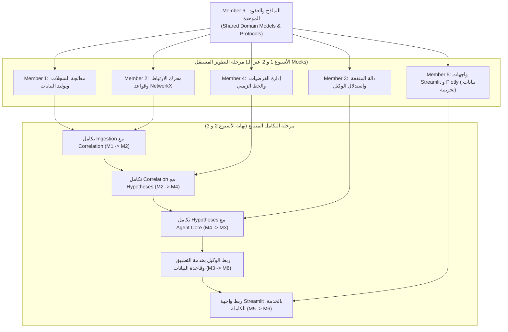

---

## 14. Parallel Development Strategy (استراتيجية التطوير المتوازي عبر الـ Mocks)

لمنع حدوث سيناريو الاختناق الكلاسيكي: *(العضو 5 ينتظر 4، و4 ينتظر 2، و2 ينتظر 1)*، يعتمد التصميم استراتيجية **Mock-Driven Isolation**:
1. **عقود مسبقة ملزمة في اليوم الثاني:** الاتفاق التام على `models.py` يُمكّن الجميع من العمل فوراً.
2. **استخدام Fixtures متطابقة:** يوفر العضو 6 ملف `conftest.py` يحتوي على مولدات أحداث وهمية (`mock_events`, `mock_evidence`, `mock_hypotheses`).
3. **تطوير الواجهة (Member 5):** يقوم Member 5 ببناء شاشات Streamlit ورسوم Plotly بالاعتماد على خدمة وهمية `MockInvestigationService` تُرجع بيانات مسبقة الإعداد، مما يتيح إنجاز الواجهة بالتوازي مع تطوير الخوارزميات.
4. **تطوير الوكيل (Member 3):** يختبر Member 3 دالة المنفعة $U(a)$ على حالات وهمية دون الحاجة لانتظار اكتمال معالجة السجلات الحقيقية.

---

## 15. Testing Architecture (استراتيجية الاختبار الشاملة)

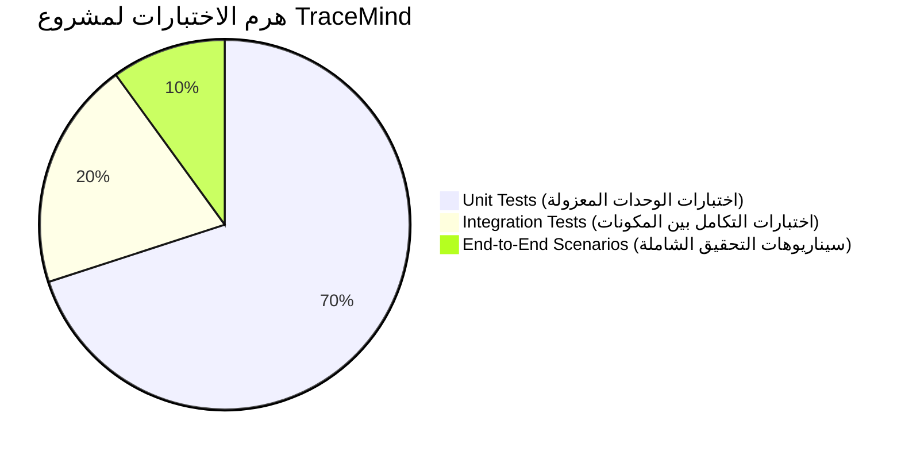

### 15.1 محاور الاختبارات
1. **Unit Tests (تغطية $\ge 80\%$):**
   - اختبار قواعد الارتباط الخمسة كلٌّ على حدة (تأكيد النتيجة الصحيحة عند تحقق الشرط وعدم إنتاج علاقة عند عدم تحققه).
   - اختبار دالة المنفعة الرياضية $U(a) = B(a) - C(a) - R(a)$ لجميع أنواع الإجراءات.
   - اختبار تحديث ثقة الفرضية وفق الأدلة الإيجابية والسلبية والناقصة.
2. **Integration Tests:**
   - تدفق الأحداث من Ingestion إلى Correlation والتأكد من بناء شبكة NetworkX بالشكل المطلوب.
   - تفاعل الوكيل مع محرك الفرضيات والتأكد من استجابة الوكيل للمعلومات المفقودة.
   - حفظ واسترجاع دورة التحقيق الكاملة من وإلى SQLite.
3. **End-to-End Scenarios:**
   - التحقق ضد 3 سيناريوهات مرجعية (`Ground Truth`):
     - **السيناريو 1 (Brute Force + Lateral Movement):** التأكد من وصول الوكيل لقرار طلب السجلات ثم التصعيد.
     - **السيناريو 2 (Normal IT Activity):** التأكد من عدم التصعيد وإغلاق التحقيق بنجاح (`CONCLUDE_INVESTIGATION`).
     - **السيناريو 3 (Contradictory Evidence):** التأكد من رفض الفرضية أو خفض ثقتها عند ظهور أدلة معارضة قاطعة.

---

## 16. Four-Week Implementation Roadmap (الخطة التنفيذية المفصلة لـ 4 أسابيع)

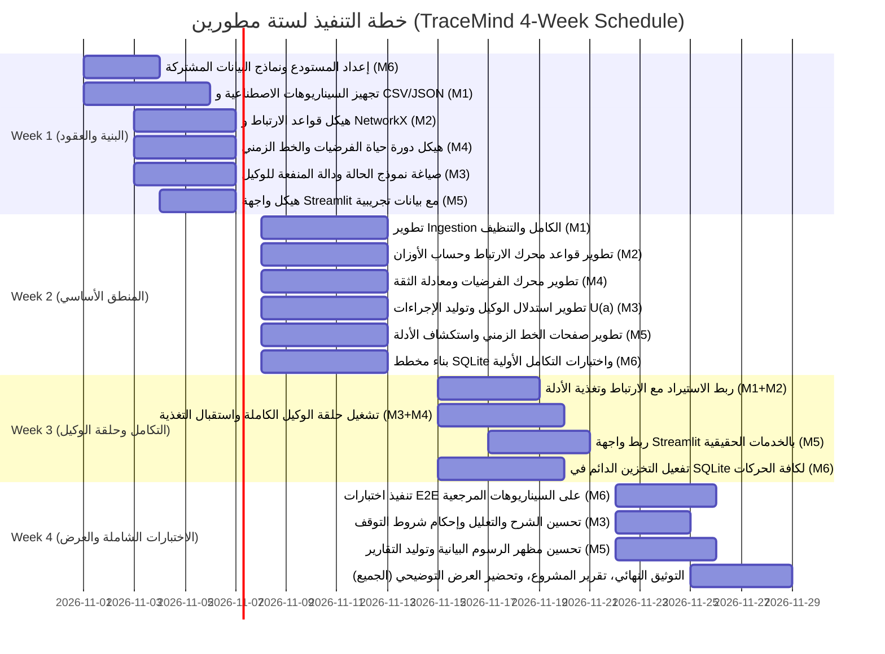

---

## 17. MVP Scope (نطاق المنتج الأولي القابل للتطبيق)

- **Must Have (ضروري جداً لإثبات الوكيل):**
  - قراءة ملفات CSV و JSON ومعالجتها وتطبيعها.
  - تطبيق قواعد الارتباط الخمسة وبناء رسم NetworkX للأدلة.
  - إدارة الفرضيات وتحديث درجات الثقة استناداً للأدلة.
  - تشغيل دورة الوكيل الذكي: توليد الإجراءات، حساب $U(a) = B - C - R$، اختيار الإجراء، والمحاكاة.
  - شرح نصي شفاف للقرارات المتخذة.
  - واجهة Streamlit تعرض الخط الزمني، شبكة الأدلة (Plotly)، وحالة الفرضيات وقرارات الوكيل.
  - حفظ واسترجاع التحقيقات عبر SQLite محلياً.
- **Should Have (مهم):**
  - تصدير تقرير التحقيق النهائي بصيغة نصية أو ملخص قابل للتنزيل.
  - معالجة تعارض الأدلة وتراجع الثقة التلقائي.
- **Out of Scope (خارج النطاق المعتمد):**
  - الاتصال بأنظمة أمنية حقيقية أو واجهات API حية لأجهزة إنتاجية.
  - استخدام نماذج لغوية ضخمة مدفوعة (LLM APIs) أو خدمات سحابية.
  - تقنيات الحاويات المعقدة (Kubernetes / Docker) وأنظمة قواعد البيانات الموزعة.

---

## 18. First Vertical Slice (الشريحة الرأسية الأولى للتحقق السريع)

لضمان سلامة الهيكل المعماري في أقرب وقت، تُحدّد الشريحة الرأسية الأولى (Vertical Slice) ليتم إنجازها واختبارها في نهاية **الأسبوع الأول / بداية الأسبوع الثاني**:

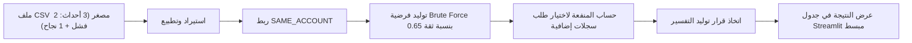

**الهدف من هذه الشريحة:** إثبات أن تدفق البيانات يمر عبر طبقات المطورين الستة بدون أخطاء توافقية في الأنواع والواجهات.

---

## 19. Architecture Decisions and Risks (سجلات القرارات والمخاطر)

### 19.1 سجلات القرارات المعمارية الرئيسية (ADR Summaries)
- **ADR-001 (Modular Monolith):** تم اعتماد الكتلي المعياري لتقليل الهدر التشغيلي والتركيز الكامل على منطق الوكيل الذكي ومناسبته للجدول الزمني المكون من 4 أسابيع.
- **ADR-002 (Utility-Based Agent Formulation):** اعتماد صياغة المنفعة $U(a) = B(a) - C(a) - R(a)$ لضمان الحتمية الرياضية وقابلية التفسير وتجنب القرارات العشوائية للنماذج غير المضبوطة.
- **ADR-003 (NetworkX for Evidence Correlation):** اعتماد NetworkX كبنية بيانات مرنة لحساب المسارات والعلاقات وتحويلها بسهولة إلى رسوم بيانية تفاعلية عبر Plotly.
- **ADR-004 (SQLite Local Storage):** استخدام SQLite المدمج مع Python دون الحاجة لتنصيب خوادم قواعد بيانات إضافية لضمان سهولة تشغيل المشروع على أجهزة المشرفين والطلاب.

### 19.2 سجل المخاطر وخطة تخفيفها (Risk Management)

| المخاطرة | الاحتمالية | الأثر | استراتيجية التخفيف والوقاية |
| :--- | :---: | :---: | :--- |
| **تضارب أعضاء الفريق في نماذج البيانات** | متوسطة | عالي جداً | حظر تعديل `app/domain/models.py` إلا بعد موافقة رسمية من مسؤول التكامل (Member 6) ومراجعة جميع الأعضاء. |
| **تداخل منطق العمل داخل Streamlit** | عالية | عالي | فرض قيود معمارية صارمة: واجهة Streamlit تستدعي دوال `InvestigationService` فقط ولا تتضمن استعلامات SQL أو حسابات منفعة. |
| **تعطل المطورين بسبب تأخر المراحل السابقة** | متوسطة | عالي | إلزام كل عضو بتوفير واجهات وهمية (Stubs/Mocks) فور تسليم العقود المشتركة لبدء العمل المتوازي. |
| **التأكيد المتسرع للاختراق (Premature Confirmation)** | متوسطة | متوسط | اشتراط خلو قائمة الأدلة الناقصة ($M = \emptyset$) وتجاوز حد الثقة ($> 0.85$) قبل تأكيد الفرضية. |

---

# خلاصة

هذه الوثيقة تمثل **المواصفات المعمارية الكاملة والتفصيلية الجاهزة للتنفيذ** لمشروع **TraceMind**. تم ضبطها بدقة لتلبي كافة متطلبات مقترح المشروع لمقرر Intelligent Agents، وتوزع المهام على المطورين الستة بالتساوي مع استقلالية تامة أثناء التطوير.
