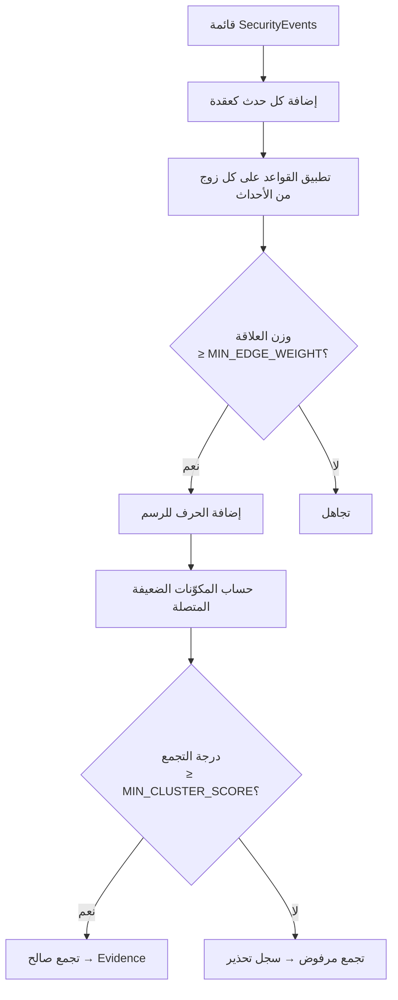
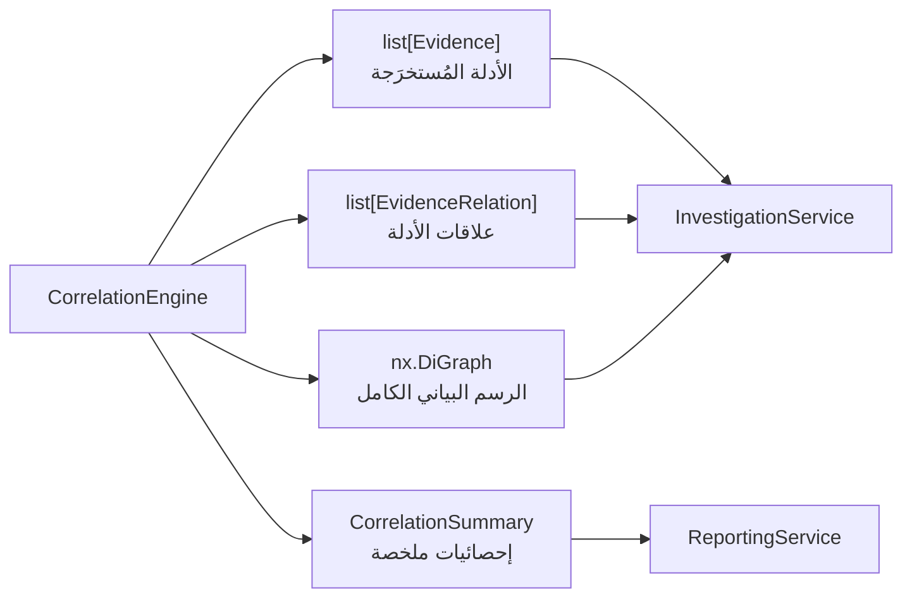

# CORRELATION_ENGINE.md — محرّك الارتباط في TraceMind

> وثيقة تقنية تصف بنية وعمل محرّك الارتباط المسؤول عن ربط الأحداث الأمنية وبناء رسم الأدلة

---

## 1. الغرض والنطاق (Purpose and Scope)

### 1.1 ما يفعله المحرّك

يتخذ `CorrelationEngine` دوراً محورياً في TraceMind: فهو **يكتشف العلاقات** بين الأحداث الأمنية المتفرقة ويُجمِّعها في تجمعات (clusters) ذات معنى تحليلي، ثم يُحوِّل هذه التجمعات إلى **أدلة منظَّمة** (`Evidence`) يستخدمها الوكيل الذكي لتقييم الفرضيات.

### 1.2 تحذير جوهري: الارتباط ≠ السببية

> [!CAUTION]
> **الارتباط لا يعني السببية.** المحرّك يكتشف *أنماطاً إحصائية وزمنية* بين الأحداث، لا يثبت أن حدثاً واحداً هو سبب حدث آخر. كل علاقة مكتشفة تحمل قيمة `confidence` تعكس قوة الارتباط، لا اليقين السببي. المحلل البشري والوكيل الذكي هما المسؤولان عن تفسير هذه الأنماط.

| يُحدِّد المحرّك | لا يدَّعي المحرّك |
|--------------|----------------|
| أن حدثَين شاركا نفس الحساب | أن الحساب المشترك يثبت الضلوع |
| أن حدثَين وقعا في نافذة زمنية واحدة | أن القرب الزمني يعني الارتباط المقصود |
| أن عنوان IP مصدراً في كلا الحدثين | أن هذا الـ IP هو المهاجم |
| وجود نمط تسلسلي (فشل تسجيل → نجاح) | أن هذا النمط هجوم بالقوة الغاشمة بالضرورة |

---

## 2. بنية رسم الأدلة (Evidence Graph Structure)

### 2.1 العقد (Nodes)

كل عقدة في الرسم البياني تُمثِّل حدثاً أمنياً `SecurityEvent`:

```python
@dataclass
class SecurityEvent:
    event_id: str              # معرّف فريد — مفتاح العقدة في الرسم
    event_type: EventType      # نوع الحدث (LOGIN_FAILURE, DATA_ACCESS, etc.)
    timestamp: datetime        # وقت الحدث الدقيق (UTC)
    account_id: str | None     # معرّف الحساب المرتبط
    device_id: str | None      # معرّف الجهاز
    source_ip: str | None      # عنوان IP المصدر
    dest_ip: str | None        # عنوان IP الهدف
    severity: int              # درجة الخطورة [1–10]
    raw_data: dict             # بيانات إضافية خام
```

**سمات العقدة في NetworkX:**
```python
node_attrs = {
    "event_type": event.event_type.value,
    "timestamp": event.timestamp.isoformat(),
    "severity": event.severity,
    "account_id": event.account_id,
    "device_id": event.device_id,
    "source_ip": event.source_ip,
    "explored": False,         # هل استكشفها الوكيل؟
    "cluster_id": None,        # معرّف التجمع المنتمي إليه
}
```

### 2.2 الأحرف (Edges)

كل حرف يُمثِّل علاقة `EvidenceRelation` بين حدثَين:

```python
@dataclass
class EvidenceRelation:
    source_event_id: str          # معرّف الحدث المصدر
    target_event_id: str          # معرّف الحدث الهدف
    relation_type: RelationType   # نوع العلاقة (انظر جدول القواعد)
    weight: float                 # قوة الارتباط [0.0, 1.0]
    confidence: float             # ثقة في صحة العلاقة [0.0, 1.0]
    temporal_delta: float | None  # الفارق الزمني بالثواني (للعلاقات الزمنية)
    rule_name: str                # اسم قاعدة الارتباط التي أنشأت هذه العلاقة
    created_at: datetime          # وقت اكتشاف العلاقة
```

**سمات الحرف في NetworkX:**
```python
edge_attrs = {
    "relation_type": relation.relation_type.value,
    "weight": relation.weight,
    "confidence": relation.confidence,
    "temporal_delta": relation.temporal_delta,
    "rule_name": relation.rule_name,
}
```

### 2.3 البنية الكاملة للرسم

```mermaid
graph LR
    E1["🔴 Event E1\nLOGIN_FAILURE\naccount: alice"] 
    E2["🔴 Event E2\nLOGIN_FAILURE\naccount: alice"]
    E3["🟡 Event E3\nLOGIN_SUCCESS\naccount: alice"]
    E4["🔵 Event E4\nDATA_ACCESS\naccount: alice\ndevice: WS-042"]
    E5["🔴 Event E5\nANOMALOUS_TRAFFIC\nIP: 192.168.1.5"]

    E1 -->|"SAME_ACCOUNT\nw=0.9, c=0.95"| E2
    E2 -->|"SAME_ACCOUNT\nw=0.9, c=0.95"| E3
    E3 -->|"SAME_ACCOUNT\nw=0.9, c=0.95"| E4
    E1 -->|"TEMPORALLY_RELATED\nΔt=45s, w=0.99"| E2
    E3 -->|"TEMPORAL_RELATED\nΔt=120s, w=0.97"| E4
    E4 -->|"NETWORK_RELATED\nw=0.8, c=0.85"| E5

    style E1 fill:#E74C3C,color:#fff
    style E2 fill:#E74C3C,color:#fff
    style E3 fill:#F39C12,color:#fff
    style E4 fill:#3498DB,color:#fff
    style E5 fill:#E74C3C,color:#fff
```



---

## 3. جدول قواعد الارتباط (Correlation Rules)

| اسم القاعدة | شرط التفعيل | نوع العلاقة | صيغة الوزن | الثقة الافتراضية |
|------------|-----------|-----------|-----------|----------------|
| `SAME_ACCOUNT` | الحدثان يشتركان في `account_id` (غير `None`) | `SAME_ACCOUNT` | `0.9` (ثابت) | `0.95` |
| `SAME_DEVICE` | الحدثان يشتركان في `device_id` (غير `None`) | `SAME_DEVICE` | `0.85` (ثابت) | `0.90` |
| `TEMPORAL_WINDOW` | `abs(t2 - t1) ≤ threshold_seconds` | `TEMPORALLY_RELATED` | `1 - Δt / threshold` | يتفاوت (انظر §4) |
| `NETWORK_PAIR` | `e1.source_ip == e2.dest_ip` أو `e1.dest_ip == e2.source_ip` | `NETWORK_RELATED` | `0.8` (ثابت) | `0.85` |
| `SAME_INDICATOR` | تطابق مؤشر IoC: IP أو hash أو username | `SAME_INDICATOR` | `0.95` (ثابت) | `0.90` |

### 3.1 تفاصيل تطبيق كل قاعدة

#### SAME_ACCOUNT
```python
def apply_same_account_rule(e1: SecurityEvent, e2: SecurityEvent) -> EvidenceRelation | None:
    if e1.account_id and e2.account_id and e1.account_id == e2.account_id:
        return EvidenceRelation(
            source_event_id=e1.event_id,
            target_event_id=e2.event_id,
            relation_type=RelationType.SAME_ACCOUNT,
            weight=0.9,
            confidence=0.95,
            temporal_delta=abs((e2.timestamp - e1.timestamp).total_seconds()),
            rule_name="SAME_ACCOUNT",
        )
    return None
```

#### TEMPORAL_WINDOW
```python
def apply_temporal_rule(
    e1: SecurityEvent,
    e2: SecurityEvent,
    threshold: float = 3600.0,  # النافذة الافتراضية: ساعة واحدة
) -> EvidenceRelation | None:
    delta = abs((e2.timestamp - e1.timestamp).total_seconds())
    if delta <= threshold:
        weight = 1.0 - (delta / threshold)
        confidence = min(0.95, weight + 0.1)  # الثقة أعلى قليلاً من الوزن
        return EvidenceRelation(
            source_event_id=e1.event_id,
            target_event_id=e2.event_id,
            relation_type=RelationType.TEMPORALLY_RELATED,
            weight=weight,
            confidence=confidence,
            temporal_delta=delta,
            rule_name="TEMPORAL_WINDOW",
        )
    return None
```

#### SAME_INDICATOR
```python
def apply_same_indicator_rule(e1: SecurityEvent, e2: SecurityEvent) -> list[EvidenceRelation]:
    relations = []
    # مقارنة عناوين IP
    for ip_field in ["source_ip", "dest_ip"]:
        ip1 = getattr(e1, ip_field)
        ip2 = getattr(e2, ip_field)
        if ip1 and ip2 and ip1 == ip2:
            relations.append(EvidenceRelation(..., rule_name="SAME_INDICATOR"))
    # مقارنة هاشات الملفات
    h1 = e1.raw_data.get("file_hash")
    h2 = e2.raw_data.get("file_hash")
    if h1 and h2 and h1 == h2:
        relations.append(EvidenceRelation(..., rule_name="SAME_INDICATOR"))
    return relations
```

---

## 4. تهيئة النافذة الزمنية (Temporal Window Configuration)

### 4.1 النوافذ الزمنية المُعرَّفة مسبقاً

| اسم النافذة | المدة (ثانية) | الاستخدام | في `config.py` |
|------------|-------------|---------|--------------|
| `DEFAULT_WINDOW` | `3600` (ساعة) | الارتباط العام بين الأحداث | `TEMPORAL_WINDOW_DEFAULT = 3600` |
| `SHORT_WINDOW` | `300` (5 دقائق) | اكتشاف أنماط Brute Force | `TEMPORAL_WINDOW_SHORT = 300` |
| `LONG_WINDOW` | `86400` (24 ساعة) | أنماط APT (التهديدات المستمرة) | `TEMPORAL_WINDOW_LONG = 86400` |

### 4.2 منطق اختيار النافذة تلقائياً

```python
def select_temporal_window(e1: SecurityEvent, e2: SecurityEvent) -> float:
    """يختار النافذة الزمنية المناسبة بناءً على نوعَي الحدثَين."""
    brute_force_types = {EventType.LOGIN_FAILURE, EventType.AUTH_ATTEMPT}
    
    if e1.event_type in brute_force_types and e2.event_type in brute_force_types:
        return config.TEMPORAL_WINDOW_SHORT  # 300 ثانية لأنماط القوة الغاشمة
    
    apt_types = {EventType.DATA_EXFILTRATION, EventType.LATERAL_MOVEMENT}
    if e1.event_type in apt_types or e2.event_type in apt_types:
        return config.TEMPORAL_WINDOW_LONG  # 24 ساعة لأنماط APT
    
    return config.TEMPORAL_WINDOW_DEFAULT  # ساعة للحالات العامة
```

---

## 5. ملاحظات تطبيق NetworkX

### 5.1 نوع الرسم البياني

يُستخدَم `nx.DiGraph` (رسم موجَّه) لأسباب جوهرية:
- الأحداث الأمنية لها **ترتيب زمني** يمثِّل توجيهاً طبيعياً (A → B إذا وقع A قبل B)
- العلاقات قد تكون **غير متماثلة**: حدث يستدعي التحقيق في حدث آخر، لا العكس
- الخوارزميات الموجَّهة (كالمسارات الموجَّهة) أكثر صلة بالتحقيق الجنائي

### 5.2 خوارزميات التجوُّل المستخدَمة

| الخوارزمية | الاستخدام | الدالة في NetworkX |
|-----------|---------|------------------|
| BFS من عقدة | اكتشاف الأحداث المرتبطة بحدث بداية | `nx.bfs_tree(G, source)` |
| الكشف عن التجمعات | تجميع الأحداث المترابطة | `nx.weakly_connected_components(G)` |
| مركزية العقد | تحديد الأحداث المحورية للتحقيق | `nx.betweenness_centrality(G, weight='weight')` |
| المسارات الأقصر | تتبع سلسلة الأحداث من البداية للنهاية | `nx.shortest_path(G, source, target, weight='weight')` |
| كشف الدورات | اكتشاف الأنماط الدورية غير الطبيعية | `nx.find_cycle(G)` |

### 5.3 إضافة العقد والأحرف

```python
class CorrelationEngine:
    def __init__(self):
        self.graph: nx.DiGraph = nx.DiGraph()
    
    def add_event(self, event: SecurityEvent) -> None:
        """إضافة حدث كعقدة في الرسم البياني."""
        self.graph.add_node(
            event.event_id,
            event_type=event.event_type.value,
            timestamp=event.timestamp,
            severity=event.severity,
            account_id=event.account_id,
            device_id=event.device_id,
            source_ip=event.source_ip,
            explored=False,
        )
    
    def add_relation(self, relation: EvidenceRelation) -> None:
        """إضافة علاقة كحرف في الرسم البياني."""
        self.graph.add_edge(
            relation.source_event_id,
            relation.target_event_id,
            relation_type=relation.relation_type.value,
            weight=relation.weight,
            confidence=relation.confidence,
            temporal_delta=relation.temporal_delta,
            rule_name=relation.rule_name,
        )
```

---

## 6. حساب درجة الارتباط (Correlation Score Computation)

### 6.1 درجة ارتباط التجمع

لكل تجمع من الأحداث المترابطة، يُحسَب `cluster_correlation_score` كالتالي:

$$\text{ClusterScore}(C) = \frac{\sum_{(u,v) \in E_C} w_{uv} \cdot c_{uv}}{|E_C| + \alpha}$$

حيث:
- $E_C$ = مجموعة الأحرف داخل التجمع
- $w_{uv}$ = وزن الحرف بين العقدتين $u$ و $v$
- $c_{uv}$ = ثقة الحرف
- $\alpha = 1$ (عامل تنعيم لتجنب القسمة على صفر)

```python
def compute_cluster_score(self, cluster: set[str]) -> float:
    subgraph = self.graph.subgraph(cluster)
    edges = subgraph.edges(data=True)
    
    if not edges:
        return 0.0
    
    total_score = sum(
        data["weight"] * data["confidence"]
        for _, _, data in edges
    )
    return total_score / (subgraph.number_of_edges() + 1)
```

### 6.2 الحد الأدنى للاعتبار ضمن التجمع

```python
# config.py
MIN_CLUSTER_SCORE = 0.3        # الحد الأدنى لاعتبار أحداث في نفس التجمع
MIN_EDGE_WEIGHT = 0.2          # الحد الأدنى لوزن الحرف لإضافته للرسم
MIN_EDGE_CONFIDENCE = 0.5      # الحد الأدنى للثقة في علاقة لاعتبارها
```

### 6.3 خوارزمية بناء التجمعات



---

## 7. المُخرَجات (Output)

### 7.1 قائمة الأدلة المُستخرَجة

```python
@dataclass
class Evidence:
    evidence_id: str                    # معرّف فريد
    evidence_type: EvidenceType         # نوع الدليل (BEHAVIORAL, NETWORK, etc.)
    related_event_ids: list[str]        # الأحداث المكوِّنة لهذا الدليل
    hypothesis_ids: list[str]           # الفرضيات ذات الصلة
    direction: EvidenceDirection        # SUPPORTING / CONTRADICTING / NEUTRAL
    strength: float                     # قوة الدليل [0.0, 1.0]
    confidence: float                   # ثقة في الدليل [0.0, 1.0]
    description: str                    # وصف نصي للدليل
    created_at: datetime
```

### 7.2 قائمة علاقات الأدلة

```python
list[EvidenceRelation]  # كل أحرف الرسم البياني المُصفَّاة
```

### 7.3 إحصائيات ملخص الارتباط

```python
@dataclass
class CorrelationSummary:
    total_events_processed: int
    total_relations_found: int
    total_clusters: int
    valid_clusters: int                 # الدليل: clusters فوق الحد الأدنى
    noise_clusters: int                 # تجمعات مرفوضة
    avg_cluster_score: float
    max_cluster_size: int
    processing_time_ms: float
    rules_triggered: dict[str, int]     # عدد مرات تفعيل كل قاعدة
```

### 7.4 تدفق المُخرَجات الكاملة



---

*آخر تحديث: 2026 — وثيقة تقنية حية تتطور مع تطوير المحرّك*
