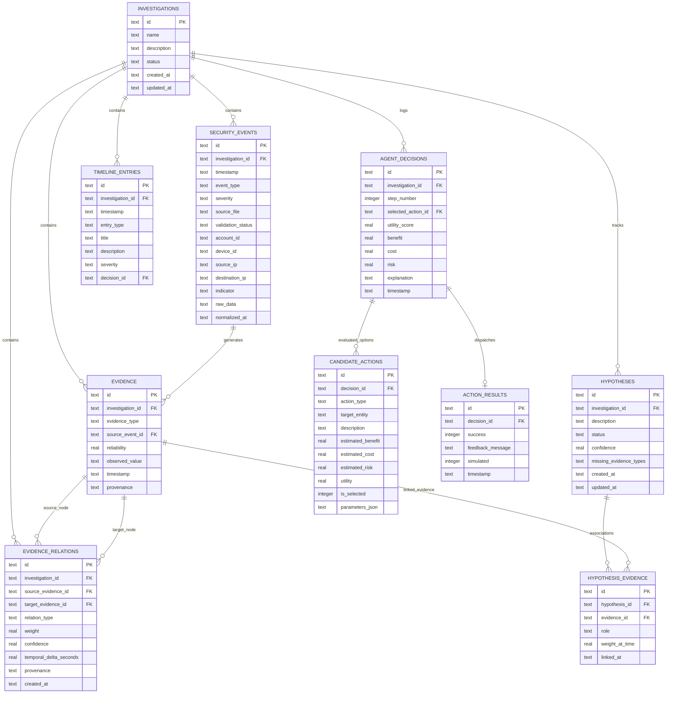

# TraceMind — وثيقة قاعدة البيانات ومخطط التخزين (Data Model & Storage Design)

[العودة إلى المعمارية الرئيسية (Main Architecture)](ARCHITECTURE.md)

---

## 1. استراتيجية التخزين وفلسفة التطبيع (Storage Strategy)

يعتمد نظام **TraceMind** على محرك **SQLite** كقاعدة بيانات محلية خفيفة وقوية تلبي متطلبات المشروع الأكاديمي. تم تصميم المخطط وفق قواعد التطبيع العلائقي (Relational Normalization) لتفادي تكرار البيانات وحماية سلامة المراجع عبر القيود الصارمة (`FOREIGN KEY Constraints`).

### 1.1 حسم العلاقة بين `agent_decisions` و `candidate_actions`
لمنع أي تعارض مرجعي (Referential Inconsistency) وحل مشكلة التبعية الدائرية بين القرار وخياراته، تم ضبط العلاقة بالتصميم التالي:
1. **جدول `agent_decisions`:** يمثل سجل القرار النهائي المعتمد في كل خطوة تحقيقية ويحمل الحقل `selected_action_id` لربط الإجراء الفائز. يُعرّف المفتاح الأجنبي كـ `DEFERRABLE INITIALLY DEFERRED` لتمكين المعاملة البرمجية (Transaction) من إدراج سجل القرار وبدائله معاً دون تعارض لحظي.
2. **جدول `candidate_actions`:** يوثق كافة الخيارات البديلة التي قيّمها الوكيل في الخطوة التحقيقية عبر المفتاح الأجنبي `decision_id` (`ON DELETE CASCADE`).
3. **منع اختيار أكثر من إجراء مرشح للقرار الواحد (Constraint Enforcement):**
   - يحتوي جدول `candidate_actions` على عمود `is_selected INTEGER NOT NULL DEFAULT 0 CHECK(is_selected IN (0, 1))`.
   - يتم فرض قيد صارم ومباشر على مستوى محرك SQLite عبر **فهرس جزئي فريد (Partial Unique Index)**:
     ```sql
     CREATE UNIQUE INDEX uq_selected_candidate_per_decision 
     ON candidate_actions(decision_id) WHERE is_selected = 1;
     ```
   - هذا الفهرس يمنع قاعدة البيانات فيزيائياً من تخزين أكثر من إجراء واحد يحمل `is_selected = 1` لنفس القرار `decision_id`، مما يضمن اتساقاً مرجعياً حتمياً غير قابل للخرق.

### 1.2 الفصل بين المخزن والمحسوب ديناميكياً
| الكيان | حالة التخزين | مبرر القرار |
| :--- | :--- | :--- |
| **الأحداث الأمنية (`security_events`)** | دائم في SQLite | الاحتفاظ بالأدلة الرقمية وسجلات التتبع الكاملة للتحقيق. |
| **الأدلة والعلاقات (`evidence`, `evidence_relations`)** | دائم في SQLite | تمكين التحليل التاريخي واستعادة حالة التحقيق عند إعادة فتح الجلسة. |
| **رسم الأدلة (`nx.MultiDiGraph`)** | **محسوب ديناميكياً في الذاكرة (In-Memory)** | سرعة إجراء العمليات الحسابية والمسارات؛ يُعاد بناؤه فوراً من جداول الأدلة والعلاقات. |
| **ربط الفرضيات بالأدلة (`hypothesis_evidence`)** | دائم في SQLite (جدول ربط علائقي) | يتيح الاستعلام المباشر عن الأدلة الداعمة والمعارضة لكل فرضية دون تفكيك سلاسل JSON. |
| **خيارات القرارات البديلة (`candidate_actions`)** | دائم في SQLite | توثيق كافة البدائل التي درسها الوكيل لضمان تدقيق القرارات بالكامل (Full Auditability). |
| **مصفوفة المسافات الزمنية المؤقتة** | **محسوبة ديناميكياً** | لا حاجة لتخزين الفوارق المؤقتة التي تتغير مع تدفق أحداث جديدة. |

---

## 2. مخطط الكيانات والعلاقات الكامل (Entity Relationship Diagram - ERD)



---

## 3. مواصفات الجداول ومخطط الـ DDL القياسي (Complete SQL Schema)

```sql
-- تفعيل التحقق من تكامل المفاتيح الأجنبية
PRAGMA foreign_keys = ON;

-- 1. جدول التحقيقات الرئيسي
CREATE TABLE IF NOT EXISTS investigations (
    id TEXT PRIMARY KEY,
    name TEXT NOT NULL,
    description TEXT,
    status TEXT NOT NULL CHECK(status IN ('ACTIVE', 'PAUSED', 'ESCALATED', 'COMPLETED', 'CLOSED')),
    created_at TEXT NOT NULL,
    updated_at TEXT NOT NULL
);

-- 2. جدول الأحداث الأمنية المنظفة
CREATE TABLE IF NOT EXISTS security_events (
    id TEXT PRIMARY KEY,
    investigation_id TEXT NOT NULL,
    timestamp TEXT NOT NULL,
    event_type TEXT NOT NULL,
    severity TEXT NOT NULL CHECK(severity IN ('INFO', 'LOW', 'MEDIUM', 'HIGH', 'CRITICAL')),
    source_file TEXT NOT NULL,
    validation_status TEXT NOT NULL CHECK(validation_status IN ('VALID', 'INVALID', 'NEEDS_REVIEW', 'DUPLICATE')),
    account_id TEXT,
    device_id TEXT,
    source_ip TEXT,
    destination_ip TEXT,
    indicator TEXT,
    raw_data TEXT, -- JSON مبرر لحفظ السجل الأصلي غير المتجانس
    normalized_at TEXT NOT NULL,
    FOREIGN KEY (investigation_id) REFERENCES investigations(id) ON DELETE CASCADE
);

-- 3. جدول الأدلة المستخلصة
CREATE TABLE IF NOT EXISTS evidence (
    id TEXT PRIMARY KEY,
    investigation_id TEXT NOT NULL,
    evidence_type TEXT NOT NULL,
    source_event_id TEXT NOT NULL,
    reliability REAL NOT NULL CHECK(reliability >= 0.0 AND reliability <= 1.0),
    observed_value TEXT NOT NULL,
    timestamp TEXT NOT NULL,
    provenance TEXT NOT NULL,
    FOREIGN KEY (investigation_id) REFERENCES investigations(id) ON DELETE CASCADE,
    FOREIGN KEY (source_event_id) REFERENCES security_events(id) ON DELETE RESTRICT
);

-- 4. جدول حواف شبكة الأدلة (Relations)
CREATE TABLE IF NOT EXISTS evidence_relations (
    id TEXT PRIMARY KEY,
    investigation_id TEXT NOT NULL,
    source_evidence_id TEXT NOT NULL,
    target_evidence_id TEXT NOT NULL,
    relation_type TEXT NOT NULL,
    weight REAL NOT NULL CHECK(weight >= 0.0 AND weight <= 1.0),
    confidence REAL NOT NULL CHECK(confidence >= 0.0 AND confidence <= 1.0),
    temporal_delta_seconds REAL,
    provenance TEXT NOT NULL,
    created_at TEXT NOT NULL,
    FOREIGN KEY (investigation_id) REFERENCES investigations(id) ON DELETE CASCADE,
    FOREIGN KEY (source_evidence_id) REFERENCES evidence(id) ON DELETE CASCADE,
    FOREIGN KEY (target_evidence_id) REFERENCES evidence(id) ON DELETE CASCADE
);

-- 5. جدول الفرضيات
CREATE TABLE IF NOT EXISTS hypotheses (
    id TEXT PRIMARY KEY,
    investigation_id TEXT NOT NULL,
    description TEXT NOT NULL,
    status TEXT NOT NULL CHECK(status IN ('OPEN', 'SUPPORTED', 'WEAKENED', 'REJECTED', 'ESCALATED', 'CONFIRMED')),
    confidence REAL NOT NULL CHECK(confidence >= 0.0 AND confidence <= 1.0),
    missing_evidence_types TEXT, -- JSON مبرر لقائمة الأنواع المفقودة فقط
    created_at TEXT NOT NULL,
    updated_at TEXT NOT NULL,
    FOREIGN KEY (investigation_id) REFERENCES investigations(id) ON DELETE CASCADE
);

-- 6. جدول الربط الصريح بين الفرضيات والأدلة (Junction Table)
CREATE TABLE IF NOT EXISTS hypothesis_evidence (
    id TEXT PRIMARY KEY,
    hypothesis_id TEXT NOT NULL,
    evidence_id TEXT NOT NULL,
    role TEXT NOT NULL CHECK(role IN ('SUPPORTING', 'CONTRADICTING')),
    weight_at_time REAL NOT NULL,
    linked_at TEXT NOT NULL,
    FOREIGN KEY (hypothesis_id) REFERENCES hypotheses(id) ON DELETE CASCADE,
    FOREIGN KEY (evidence_id) REFERENCES evidence(id) ON DELETE RESTRICT,
    UNIQUE(hypothesis_id, evidence_id)
);

-- 7. جدول قرارات الوكيل الذكي
CREATE TABLE IF NOT EXISTS agent_decisions (
    id TEXT PRIMARY KEY,
    investigation_id TEXT NOT NULL,
    step_number INTEGER NOT NULL,
    selected_action_id TEXT NOT NULL,
    utility_score REAL NOT NULL,
    benefit REAL NOT NULL,
    cost REAL NOT NULL,
    risk REAL NOT NULL,
    explanation TEXT NOT NULL,
    timestamp TEXT NOT NULL,
    FOREIGN KEY (investigation_id) REFERENCES investigations(id) ON DELETE CASCADE,
    FOREIGN KEY (selected_action_id) REFERENCES candidate_actions(id) DEFERRABLE INITIALLY DEFERRED
);

-- 8. جدول الإجراءات المرشحة التي درسها الوكيل (Alternative Options)
CREATE TABLE IF NOT EXISTS candidate_actions (
    id TEXT PRIMARY KEY,
    decision_id TEXT NOT NULL,
    action_type TEXT NOT NULL,
    target_entity TEXT,
    description TEXT NOT NULL,
    estimated_benefit REAL NOT NULL,
    estimated_cost REAL NOT NULL,
    estimated_risk REAL NOT NULL,
    utility REAL NOT NULL,
    is_selected INTEGER NOT NULL DEFAULT 0 CHECK(is_selected IN (0, 1)),
    parameters_json TEXT, -- JSON مبرر لبارامترات الإجراء
    FOREIGN KEY (decision_id) REFERENCES agent_decisions(id) ON DELETE CASCADE
);

-- الفهرس الجزئي الفريد الحاسم: يضمن منع اختيار أكثر من مرشح واحد لنفس القرار
CREATE UNIQUE INDEX IF NOT EXISTS uq_selected_candidate_per_decision 
ON candidate_actions(decision_id) WHERE is_selected = 1;

-- 9. جدول نتائج تنفيذ الإجراءات في بيئة المحاكاة
CREATE TABLE IF NOT EXISTS action_results (
    id TEXT PRIMARY KEY,
    decision_id TEXT NOT NULL UNIQUE,
    success INTEGER NOT NULL CHECK(success IN (0, 1)),
    feedback_message TEXT NOT NULL,
    simulated INTEGER DEFAULT 1,
    timestamp TEXT NOT NULL,
    FOREIGN KEY (decision_id) REFERENCES agent_decisions(id) ON DELETE CASCADE
);

-- 10. جدول إدخالات الخط الزمني
CREATE TABLE IF NOT EXISTS timeline_entries (
    id TEXT PRIMARY KEY,
    investigation_id TEXT NOT NULL,
    timestamp TEXT NOT NULL,
    entry_type TEXT NOT NULL,
    title TEXT NOT NULL,
    description TEXT NOT NULL,
    severity TEXT,
    decision_id TEXT,
    FOREIGN KEY (investigation_id) REFERENCES investigations(id) ON DELETE CASCADE,
    FOREIGN KEY (decision_id) REFERENCES agent_decisions(id) ON DELETE SET NULL
);

-- ============================================================================
-- فهارس تحسين أداء الاستعلامات (Indexes)
-- ============================================================================
CREATE INDEX IF NOT EXISTS idx_events_inv_time ON security_events(investigation_id, timestamp);
CREATE INDEX IF NOT EXISTS idx_evidence_inv ON evidence(investigation_id);
CREATE INDEX IF NOT EXISTS idx_relations_source ON evidence_relations(source_evidence_id);
CREATE INDEX IF NOT EXISTS idx_relations_target ON evidence_relations(target_evidence_id);
CREATE INDEX IF NOT EXISTS idx_hypo_evidence_pair ON hypothesis_evidence(hypothesis_id, role);
CREATE INDEX IF NOT EXISTS idx_decisions_step ON agent_decisions(investigation_id, step_number);
CREATE INDEX IF NOT EXISTS idx_candidates_decision ON candidate_actions(decision_id);
CREATE INDEX IF NOT EXISTS idx_timeline_time ON timeline_entries(investigation_id, timestamp);
```

[العودة إلى المعمارية الرئيسية (Main Architecture)](ARCHITECTURE.md)
