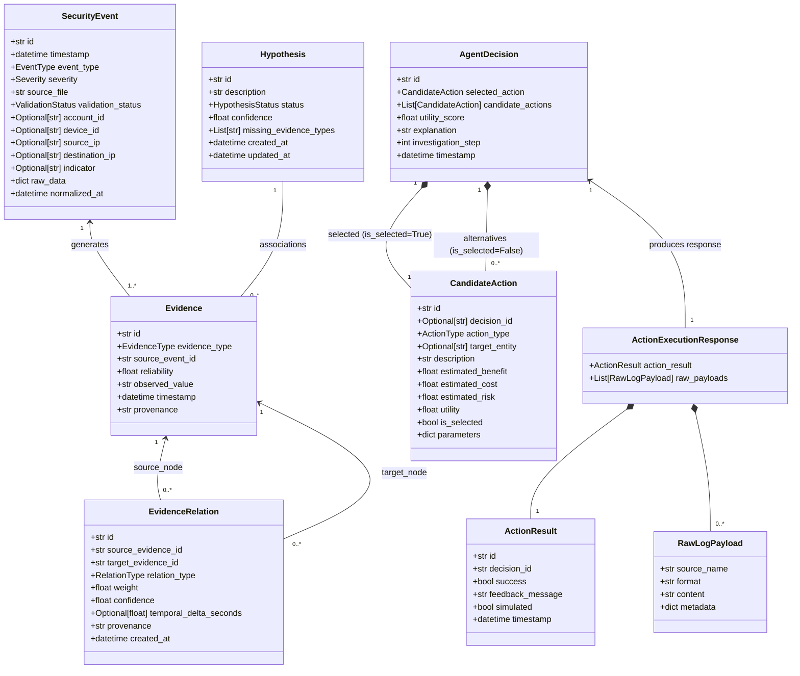

# TraceMind — وثيقة النموذج المجالي وعقود الواجهات (Domain Model & Service Contracts)

[العودة إلى المعمارية الرئيسية (Main Architecture)](ARCHITECTURE.md)

---

## 1. فلسفة النموذج المجالي الموحد (Single Source of Truth)

يمثل هذا الملف المرجع القياسي الوحيد والمشترك لجميع هياكل البيانات، الحالات، والعقود البرمجية التي تلتزم بها كافة وحدات نظام **TraceMind**. يمنع منعاً باتاً قيام أي عضو من المطورين الستة بتعريف هياكل بيانات موازية أو مستقلة داخل حزمته البرمجية.

---

## 2. التصنيفات الثابتة (Domain Enums)

```python
class EventType(str, Enum):
    LOGIN_FAILED = "LOGIN_FAILED"
    LOGIN_SUCCESS = "LOGIN_SUCCESS"
    NETWORK_CONNECTION = "NETWORK_CONNECTION"
    FILE_ACCESS = "FILE_ACCESS"
    PROCESS_EXEC = "PROCESS_EXEC"
    PRIVILEGE_ESCALATION = "PRIVILEGE_ESCALATION"
    PORT_SCAN = "PORT_SCAN"
    DATA_EXFILTRATION = "DATA_EXFILTRATION"
    UNKNOWN = "UNKNOWN"

class Severity(str, Enum):
    INFO = "INFO"
    LOW = "LOW"
    MEDIUM = "MEDIUM"
    HIGH = "HIGH"
    CRITICAL = "CRITICAL"

class ValidationStatus(str, Enum):
    VALID = "VALID"
    INVALID = "INVALID"
    NEEDS_REVIEW = "NEEDS_REVIEW"
    DUPLICATE = "DUPLICATE"

class EvidenceType(str, Enum):
    LOG_ENTRY = "LOG_ENTRY"
    NETWORK_ARTIFACT = "NETWORK_ARTIFACT"
    ACCOUNT_ACTIVITY = "ACCOUNT_ACTIVITY"
    DEVICE_ACTIVITY = "DEVICE_ACTIVITY"
    TEMPORAL_PATTERN = "TEMPORAL_PATTERN"
    BEHAVIORAL_INDICATOR = "BEHAVIORAL_INDICATOR"

class RelationType(str, Enum):
    SAME_ACCOUNT = "SAME_ACCOUNT"
    SAME_DEVICE = "SAME_DEVICE"
    TEMPORALLY_RELATED = "TEMPORALLY_RELATED"
    NETWORK_RELATED = "NETWORK_RELATED"
    SAME_INDICATOR = "SAME_INDICATOR"

class HypothesisStatus(str, Enum):
    OPEN = "OPEN"
    SUPPORTED = "SUPPORTED"
    WEAKENED = "WEAKENED"
    REJECTED = "REJECTED"
    ESCALATED = "ESCALATED"
    CONFIRMED = "CONFIRMED"

class ActionType(str, Enum):
    REQUEST_ADDITIONAL_LOGS = "REQUEST_ADDITIONAL_LOGS"
    ANALYZE_RELATED_EVENT = "ANALYZE_RELATED_EVENT"
    INVESTIGATE_ENTITY = "INVESTIGATE_ENTITY"
    REVIEW_EVIDENCE_RELATION = "REVIEW_EVIDENCE_RELATION"
    ESCALATE_FOR_HUMAN_REVIEW = "ESCALATE_FOR_HUMAN_REVIEW"
    CONCLUDE_INVESTIGATION = "CONCLUDE_INVESTIGATION"

class InvestigationStatus(str, Enum):
    ACTIVE = "ACTIVE"
    PAUSED = "PAUSED"
    ESCALATED = "ESCALATED"
    COMPLETED = "COMPLETED"
    CLOSED = "CLOSED"
```

---

## 3. الكيانات المجالية الأساسية (Core Domain Entities)

### 3.1 حدث أمني (`SecurityEvent`)
يمثل السجل الأمني الموحد بعد تنظيفه والتحقق منه وتطبيعه بواسطة وحدة الاستيراد (`Member 1`).

| الحقل | النوع | إلزامي؟ | الوصف |
| :--- | :--- | :---: | :--- |
| `id` | `str` (UUID) | نعم | معرف فريد للحدث |
| `timestamp` | `datetime` (UTC) | نعم | وقت وقوع الحدث محولاً إلى التوقيت العالمي الموحد |
| `event_type` | `EventType` | نعم | تصنيف الحدث الأمني |
| `severity` | `Severity` | نعم | مستوى الخطورة المبدئي للحدث |
| `source_file` | `str` | نعم | اسم الملف الأصلي الوارد منه السجل (لضمان التتبع) |
| `validation_status`| `ValidationStatus` | نعم | حالة صلاحية السجل بعد الفحص الأولي |
| `account_id` | `Optional[str]` | لا | معرف الحساب المرتبط بالحدث (مُطبّع إلى أحرف صغيرة) |
| `device_id` | `Optional[str]` | لا | معرف الجهاز أو اسم الحاسوب |
| `source_ip` | `Optional[str]` | لا | عنوان IP المصدر |
| `destination_ip` | `Optional[str]` | لا | عنوان IP الوجهة |
| `indicator` | `Optional[str]` | لا | مؤشر اختراق إضافي (تجزئة ملف، اسم نطاق) |
| `raw_data` | `dict` | لا | السجل الخام الأصلي الكامل |
| `normalized_at` | `datetime` | نعم | وقت إجراء عملية التطبيع في النظام |

### 3.2 دليل أمني (`Evidence`)
يمثل حقيقة أو ملاحظة مستخلصة من حدث أمني معزز بدرجة موثوقية (`Member 2`).

| الحقل | النوع | الوصف |
| :--- | :--- | :--- |
| `id` | `str` | معرف فريد للدليل |
| `evidence_type` | `EvidenceType` | طبيعة ونوع الدليل |
| `source_event_id` | `str` (FK) | معرف الحدث الأمني الأساسي المستخلص منه الدليل |
| `reliability` | `float` (0.0-1.0) | درجة موثوقية الدليل بناءً على صحة الحدث ومصدره |
| `observed_value` | `str` | القيمة الملاحظة (نص وصفي للنشاط) |
| `timestamp` | `datetime` | وقت وقوع النشاط |
| `provenance` | `str` | سلسلة نسب الدليل وقاعدة الاستخلاص المطبقة |

### 3.3 علاقة ارتباط بين الأدلة (`EvidenceRelation`)
تمثل حافة موجهة في رسم الأدلة تشير إلى وجود علاقة سياقية بين دليلين.

| الحقل | النوع | الوصف |
| :--- | :--- | :--- |
| `id` | `str` | معرف فريد للعلاقة |
| `source_evidence_id`| `str` (FK) | معرف الدليل المصدر |
| `target_evidence_id`| `str` (FK) | معرف الدليل الهدف |
| `relation_type` | `RelationType` | نوع الرابط السياقي (نفس الحساب، تقارب زمني، إلخ) |
| `weight` | `float` (0.0-1.0) | وزن العلاقة المعتمد في خوارزميات المسارات |
| `confidence` | `float` (0.0-1.0) | درجة الثقة في صحة العلاقة |
| `temporal_delta_seconds`| `Optional[float]` | الفارق الزمني بالثواني بين الحدثين |
| `provenance` | `str` | اسم قاعدة الارتباط التي اكتشفت العلاقة |

### 3.4 فرضية تحقيق (`Hypothesis`)
تمثل سيناريو هجوم محتمل أو تفسيراً لنشاط النظام يديره محرك الفرضيات (`Member 4`).

| الحقل | النوع | الوصف |
| :--- | :--- | :--- |
| `id` | `str` | معرف فريد للفرضية |
| `description` | `str` | وصف الفرضية (مثل: Brute Force followed by Lateral Movement) |
| `status` | `HypothesisStatus` | حالة الفرضية الحالية في دورة الحياة |
| `confidence` | `float` (0.0-1.0) | درجة الثقة الاستدلالية الحالية |
| `missing_evidence_types`| `List[str]` | قائمة أنواع الأدلة الناقصة الجوهرية لحسم الفرضية |
| `created_at` / `updated_at`| `datetime` | توقيت الإنشاء والتحديث |

---

## 4. نماذج القرارات ومحاكاة الإجراءات (Decision & Action Models)

### 4.1 إجراء مرشح (`CandidateAction`)
إجراء تحقيق استقصائي مقترح يتم تقييمه بواسطة دالة المنفعة الرياضية $U(a) = B(a) - C(a) - R(a)$.

| الحقل | النوع | الوصف |
| :--- | :--- | :--- |
| `id` | `str` | معرف الإجراء |
| `decision_id` | `Optional[str]` | معرف القرار المرتبط به في قاعدة البيانات |
| `action_type` | `ActionType` | نوع الإجراء التحقيقي |
| `target_entity` | `Optional[str]` | الكيان المستهدف بالفحص (جهاز، حساب، مؤشر) |
| `description` | `str` | شرح ما سيقوم به الإجراء |
| `estimated_benefit` | `float` | الفائدة المتوقعة $B(a)$ (تقليل عدم اليقين، كشف أدلة ناقصة) |
| `estimated_cost` | `float` | التكلفة المقدرة $C(a)$ (عبء المعالجة، عدد السجلات) |
| `estimated_risk` | `float` | المخاطرة المقدرة $R(a)$ (خطر التصعيد الخاطئ، ضعف الأدلة) |
| `utility` | `float` | قيمة المنفعة الصافية المحسوبة $U(a) = B - C - R$ |
| `is_selected` | `bool` | علامة حاسمة توضح هل هذا الإجراء هو الفائز والمختار للقرار (يضمن الفهرس الفريد أن خياراً واحداً فقط = True) |
| `parameters` | `dict` | معايير إضافية للإجراء |

### 4.2 قرار الوكيل الذكي (`AgentDecision`)
سجل قرار الوكيل المعتمد في الخطوة التحقيقية محتوياً على التعليل الكامل.

| الحقل | النوع | الوصف |
| :--- | :--- | :--- |
| `id` | `str` | معرف القرار |
| `selected_action` | `CandidateAction` | الإجراء المختار صاحب أعلى منفعة (`is_selected = True`) |
| `candidate_actions`| `List[CandidateAction]` | قائمة كافة البدائل التي درسها الوكيل وقيم منفعتها |
| `utility_score` | `float` | المنفعة الصافية للإجراء الفائز |
| `explanation` | `str` | الشرح النصي الشفاف لأسباب اختيار هذا الإجراء دون غيره |
| `investigation_step`| `int` | رقم الخطوة في دورة التحقيق |
| `timestamp` | `datetime` | وقت اتخاذ القرار |

### 4.3 نتيجة تنفيذ الإجراء (`ActionResult`)
تغذية راجعة وصفية صادرة من محاكي الإجراءات في بيئة الاختبار (`Sandbox Execution`).

| الحقل | النوع | الوصف |
| :--- | :--- | :--- |
| `id` | `str` | معرف النتيجة |
| `decision_id` | `str` (FK) | معرف القرار المنفذ |
| `success` | `bool` | هل نجح تنفيذ الإجراء ومحاكاة البيانات |
| `feedback_message` | `str` | رسالة وصفية لنتيجة التنفيذ |
| `simulated` | `bool` (True) | علامة تؤكد أن التنفيذ تم داخل بيئة محاكاة آمنة |
| `timestamp` | `datetime` | وقت التنفيذ |

---

## 5. نماذج نقل البيانات وعقود المحاكاة النمطية (Typed DTOs & Simulation Contracts)

لضمان سلامة التكامل وفصل استدلال الوكيل عن محاكاة البيانات، تُستخدم الكائنات النمطية الصريحة التالية:

```python
from dataclasses import dataclass, field
from datetime import datetime
from typing import List, Dict, Any, Optional

@dataclass(frozen=True)
class RawLogPayload:
    """حمولة سجلات خام ناتجة عن تنفيذ إجراء محاكى لجلب بيانات إضافية"""
    source_name: str                     # اسم المصدر مثل: "device_srv_002_logs.json"
    format: str                          # "CSV" أو "JSON"
    content: str                         # محتوى السجلات الخام كـ String مهيأ للاستيراد
    metadata: Dict[str, Any] = field(default_factory=dict)

@dataclass(frozen=True)
class ActionExecutionResponse:
    """الاستجابة الكاملة لمحاكي تنفيذ الإجراءات إلى منسق التحقيق"""
    action_result: ActionResult          # نتيجة وصفية للتنفيذ وتغذية راجعة
    raw_payloads: List[RawLogPayload]    # حمولات السجلات الخام الجديدة المطلوب إدخالها في خط الاستيراد

@dataclass(frozen=True)
class IngestionResult:
    events: List[SecurityEvent]
    total_parsed: int
    valid_count: int
    duplicate_count: int
    invalid_count: int
    errors: List[dict]

@dataclass(frozen=True)
class GraphNodeDTO:
    id: str
    label: str
    event_type: str
    severity: str
    timestamp: str
    reliability: float

@dataclass(frozen=True)
class GraphEdgeDTO:
    id: str
    source: str
    target: str
    relation_type: str
    weight: float
    confidence: float

@dataclass(frozen=True)
class GraphVisualData:
    nodes: List[GraphNodeDTO]
    edges: List[GraphEdgeDTO]
    cluster_count: int

@dataclass(frozen=True)
class CorrelationResult:
    evidence: List[Evidence]
    relations: List[EvidenceRelation]
    visual_graph: GraphVisualData

@dataclass(frozen=True)
class InvestigationSummary:
    investigation_id: str
    status: InvestigationStatus
    total_events: int
    total_evidence: int
    hypotheses_count: int
    highest_severity: Severity
    current_step: int
    is_completed: bool

@dataclass(frozen=True)
class InvestigationReport:
    investigation_id: str
    title: str
    generated_at: datetime
    summary: InvestigationSummary
    key_findings: List[str]
    confirmed_hypotheses: List[Hypothesis]
    timeline_highlights: List[TimelineEntry]
    decision_audit_trail: List[AgentDecision]
```

---

## 6. عقود الواجهات البرمجية المصححة (Service Protocols)

```python
class IEventIngester(Protocol):
    """عقد استيراد البيانات — Member 1"""
    def ingest_file(self, file_path: str) -> IngestionResult:
        """قراءة السجلات من ملف CSV أو JSON وتوحيدها وتصفيتها"""
        ...
    def ingest_payload(self, payload: RawLogPayload) -> IngestionResult:
        """استيعاب حمولة سجلات خام ناتجة عن المحاكاة وتوحيدها وتصفيتها"""
        ...
    def validate_events(self, events: List[SecurityEvent]) -> IngestionResult:
        """فحص تطابق الحقول الإلزامية وعزل السجلات المشوهة"""
        ...

class ICorrelationEngine(Protocol):
    """عقد محرك ربط الأدلة — Member 2"""
    def correlate(self, events: List[SecurityEvent]) -> CorrelationResult:
        """بناء علاقات الارتباط بين الأحداث في NetworkX MultiDiGraph"""
        ...
    def get_visual_data(self) -> GraphVisualData:
        """تجهيز العقد والحواف بدقة لعرضها في Plotly"""
        ...

class IHypothesisEngine(Protocol):
    """عقد محرك الفرضيات — Member 4"""
    def generate_initial_hypotheses(self, evidence: List[Evidence]) -> List[Hypothesis]:
        """صياغة الفرضيات الأولية وتحديد الأدلة المفقودة"""
        ...
    def update_hypotheses(
        self, hypotheses: List[Hypothesis], new_evidence: List[Evidence]
    ) -> List[Hypothesis]:
        """تحديث درجات الثقة الاستدلالية وحالة الفرضية بناءً على الأدلة الجديدة"""
        ...

class IAgentCore(Protocol):
    """عقد نواة الوكيل الذكي — Member 3 (استدلال نقي مفصول عن التنفيذ)"""
    def evaluate_and_decide(self, state: InvestigationState) -> AgentDecision:
        """توليد الإجراءات المرشحة، حساب المنفعة، واختيار القرار وتفسيره"""
        ...

class IActionExecutionEngine(Protocol):
    """عقد محاكي تنفيذ الإجراءات — Application Layer"""
    def execute_action(self, action: CandidateAction) -> ActionExecutionResponse:
        """تنفيذ الإجراء في بيئة المحاكاة وإرجاع نتيجة الإجراء وحمولات السجلات الخام الجديدة"""
        ...

class IInvestigationRepository(Protocol):
    """عقد مستودع التخزين في SQLite — Member 1"""
    def save_state(self, state: InvestigationState) -> None:
        ...
    def load_state(self, investigation_id: str) -> Optional[InvestigationState]:
        ...
    def record_decision(self, investigation_id: str, decision: AgentDecision) -> None:
        """حفظ القرار وجميع البدائل المرشحة مع ضبط قيد الفهرس الفريد لـ is_selected"""
        ...
```

---

## 7. مخطط العلاقات الصنفي المصحح (Class Diagram)



[العودة إلى المعمارية الرئيسية (Main Architecture)](ARCHITECTURE.md)
