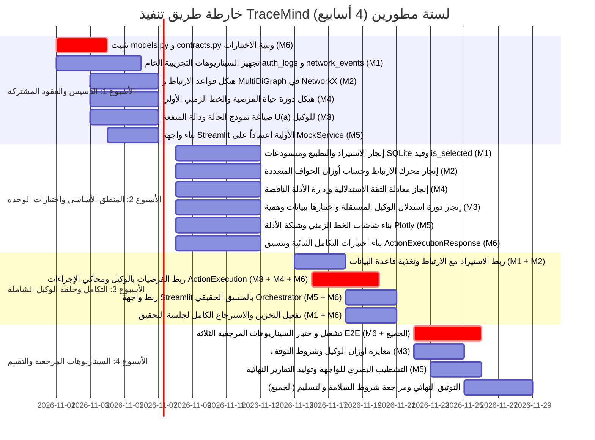
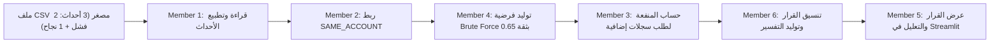

# TraceMind — وثيقة الخطة التنفيذية وخارطة الطريق (Implementation Roadmap & Execution Plan)

[العودة إلى المعمارية الرئيسية (Main Architecture)](ARCHITECTURE.md)

---

## 1. خطة التنفيذ الشاملة (Gantt Chart Roadmap)

---

## 2. تفصيل المهام الأسبوعية للمطورين الستة

### 2.1 الأسبوع الأول (Week 1): التأسيس والعقود والبيانات المصنعة
- **Member 1:**
  - بناء هيكل المجلدات وحزم `data/raw/` و `data/scenarios/`.
  - كتابة سكربت توليد السجلات التجريبية `generate_synthetic_data.py`.
  - تجهيز ملفات البيانات الأساسية: `auth_logs.csv` و `network_events.json`.
- **Member 2:**
  - دراسة NetworkX وبناء هيكل الصنف `EvidenceGraphBuilder` باستخدام `nx.MultiDiGraph`.
  - تعريف هياكل قواعد الارتباط الخمسة كدوال معزولة قابلة للاختبار.
- **Member 3:**
  - صياغة الهيكل الرياضي لحساب المنفعة في `utility_calculator.py`.
  - تصميم مصفوفة توليد الإجراءات المرشحة بناءً على عناصر `missing_information`.
- **Member 4:**
  - صياغة آلة حالات الفرضيات ودورة حياتها في `hypothesis_engine.py`.
  - كتابة خوارزمية ترتيب الأحداث والقرارات زمنياً في `timeline_builder.py`.
- **Member 5:**
  - إعداد بيئة Streamlit وإنشاء الهيكل الأساسي للصفحات في `app/ui/pages/`.
  - بناء كائن `MockInvestigationService` لتغذية الواجهة ببيانات تجريبية ثابتة.
- **Member 6 (Integration Lead):**
  - كتابة واعتماد `app/domain/models.py` و `app/domain/contracts.py` متضمنة `RawLogPayload` و `ActionExecutionResponse`.
  - إعداد بيئة الاختبار `pytest` وملف `tests/conftest.py` بالمولدات الوهمية.
  - إطلاق أول اختبار فحص دخاني (Smoke Test) يتأكد من سلامة الاستيرادات لكافة الأعضاء.

**مخرجات الأسبوع الأول ومؤشرات القبول:**
- [x] تمرير اختبارات `conftest.py` بنجاح: `pytest tests/ -v`.
- [x] إمكانية تشغيل واجهة Streamlit وعرض صفحات أولية ببيانات الـ Mock.
- [x] وجود سيناريو مرجعي أولي في `data/scenarios/scenario_01_brute_force.json`.

---

### 2.2 الأسبوع الثاني (Week 2): المنطق الأساسي واختبارات الوحدة
- **Member 1:**
  - إنجاز محللات `CSVParser` و `JSONParser` ودعم استيعاب `RawLogPayload`.
  - إنجاز محرك التطبيع `EventNormalizer` وإزالة التكرارات `EventDeduplicator`.
  - كتابة دوال التخزين والاسترجاع في `app/infrastructure/repositories.py` وضمان عمل قيد الفهرس الجزئي `uq_selected_candidate_per_decision`.
  - كتابة 15+ اختبار وحدة للحزمة الخاصة به.
- **Member 2:**
  - تنفيذ قواعد الارتباط الخمس (`SAME_ACCOUNT`, `SAME_DEVICE`, `TEMPORAL_WINDOW`, `NETWORK_RELATION`, `SAME_INDICATOR`).
  - تطبيق بناء شبكة `nx.MultiDiGraph` وتوليد كائنات `EvidenceRelation`.
  - إنجاز دالة `get_visual_data()` لتهيئة بيانات Plotly.
  - كتابة 15+ اختبار وحدة للحزمة الخاصة به.
- **Member 3:**
  - إنجاز محرك الاستدلال وحساب درجات المنفعة $U(a) = B(a) - C(a) - R(a)$ وضبط `is_selected = True`.
  - إنجاز مولد التفسيرات `DecisionExplainer` وربطه بالبيانات المحسوبة.
  - كتابة 15+ اختبار وحدة لنواة الوكيل ودالة المنفعة.
- **Member 4:**
  - إنجاز محرك الفرضيات وحساب درجة الثقة الاستدلالية وفق معادلة العقوبات.
  - إنجاز كاشف الأدلة الناقصة الجوهرية لكل فرضية.
  - إنجاز بناء الخط الزمني الموحد `TimelineBuilder`.
  - كتابة 15+ اختبار وحدة للحزمة الخاصة به.
- **Member 5:**
  - ربط شاشات Streamlit بالـ DTOs المعيارية.
  - بناء رسومات Plotly التفاعلية لشبكة الأدلة والخط الزمني.
  - بناء صفحة شجرة الفرضيات ومستويات الثقة.
- **Member 6:**
  - بناء منسق التطبيق `InvestigationOrchestrator` ومحاكي الإجراءات `ActionExecutionEngine` لإرجاع `ActionExecutionResponse`.
  - كتابة اختبارات تكامل خط الاستيعاب مع الارتباط: `test_ingestion_correlation.py`.

**مخرجات الأسبوع الثاني ومؤشرات القبول:**
- [x] اجتياز 60+ اختبار وحدة (Unit Tests) بنسبة تغطية $\ge 80\%$.
- [x] استيراد 50 سجلاً من ملف CSV وتوليد قائمة كائنات `SecurityEvent` بنجاح.
- [x] استخراج علاقات ارتباط صحيحة وبناء رسم `MultiDiGraph` لعقد وأدلة حقيقية.
- [x] التحقق من أن محاولة إدخال أكثر من خيار مرشح يحمل `is_selected = 1` لنفس القرار في SQLite يفشل بحتمية القيد `uq_selected_candidate_per_decision`.

---

### 2.3 الأسبوع الثالث (Week 3): التكامل وحلقة الوكيل الشاملة
- **Member 1 + Member 2:** ربط مخرجات الاستيراد مع محرك الارتباط، وتأكيد حفظ الأحداث والأدلة والعلاقات في SQLite.
- **Member 3 + Member 4 + Member 6:**
  - ربط نواة الوكيل بمنسق التحقيق `Orchestrator` ومحرك الفرضيات ومحاكي الإجراءات.
  - تفعيل حلقة الاستدلال التكرارية: استدلال الوكيل $\to$ اختيار القرار $\to$ تنفيذ المحاكاة وإرجاع `ActionExecutionResponse` $\to$ استيعاب الحمولات الخام وتطبيعها $\to$ تحديث الفرضيات $\to$ تحديث الحالة.
- **Member 5 + Member 6:**
  - استبدال الـ MockService في Streamlit بالمنسق الحقيقي `InvestigationService`.
  - التأكد من تحديث الواجهة التفاعلية خطوة بخطوة عند الضغط على "Execute Next Step".
- **Member 1:**
  - تفعيل حفظ جلسة التحقيق الكاملة وسجل القرارات في SQLite وقابليتها للاسترجاع.

**مخرجات الأسبوع الثالث ومؤشرات القبول:**
- [x] تشغيل سيناريو التحقيق كاملاً عبر واجهة Streamlit من لحظة اختيار الملفات حتى إنهاء التحقيق.
- [x] استجابة الوكيل لنقص البيانات بطلب سجلات إضافية واستيعاب الحمولات الخام المحاكاة تلقائياً.
- [x] اجتياز اختبارات التكامل الشاملة بنجاح.

---

### 2.4 الأسبوع الرابع (Week 4): التحقق من السيناريوهات المرجعية والتقييم النهائي
- **Member 6 (بمشاركة الجميع):**
  - تشغيل واختبار السيناريوهات المرجعية الثلاثة (Brute Force, Normal Activity, Contradictory Evidence).
  - قياس مؤشرات الدقة (Accuracy, Precision, Recall) وتوثيق استقرار حلقة الوكيل.
- **Member 3:**
  - معايرة أوزان دالة المنفعة وشروط التوقف لضمان تفادي التصعيد الخاطئ والتأكيد المتسرع.
  - مراجعة جودة التفسيرات النصية الصادرة من الوكيل.
- **Member 5:**
  - التشطيب النهائي لواجهة المستخدم والرسوم البيانية وتصدير تقارير التحقيق (PDF / Markdown Export).
- **الجميع:**
  - إنجاز التوثيق النهائي ومراجعة شروط السلامة والتأكد من خلو المشروع من أي اعتمادات خارجية غير مصرح بها.
  - تحضير العرض التوضيحي (Final Demo Walkthrough).

---

## 3. الشريحة الرأسية الأولى (First Vertical Slice)

لضمان سلامة الهيكل المعماري والربط بين المطورين في نهاية **الأسبوع الأول / بداية الأسبوع الثاني**، تُنفذ هذه الشريحة المصغرة:

---

## 4. حدود ونطاق المنتج الأولي (MVP Scope Boundaries)

### 4.1 ما يجب توفره حتماً (Must Have):
- استيعاب سجلات CSV و JSON ومعالجتها وتطبيعها بالكامل، ودعم استيعاب حمولات `RawLogPayload`.
- تطبيق قواعد الارتباط الخمسة وبناء رسم `nx.MultiDiGraph` للأدلة.
- إدارة الفرضيات وحساب درجة الثقة الاستدلالية وتحديد الأدلة الناقصة.
- تشغيل دورة الوكيل الذكي: تقييم المنفعة $U(a) = B - C - R$، واختيار الإجراء، والمحاكاة الآمنة عبر `ActionExecutionResponse`.
- توفير تعليل نصي شفاف ومفسر لكل قرار يتخذه الوكيل.
- لوحة تحكم تفاعلية عبر Streamlit تعرض الخط الزمني وشبكة الأدلة والفرضيات وقرارات الوكيل.
- تخزين واسترجاع التحقيقات بالكامل محلياً عبر قاعدة بيانات SQLite مع التحقق من قيود الفهارس الفريدة.

### 4.2 ما يُفضل توفره (Should Have):
- تصدير تقرير التحقيق النهائي بصيغة نصية أو Markdown قابل للتنزيل.
- مصفوفة مقارنة الأداء لقرارات الوكيل عبر السيناريوهات المرجعية الثلاثة.

### 4.3 ما هو خارج النطاق تماماً (Out of Scope):
- أي محاولة للاتصال بشبكات حقيقية أو تنفيذ أوامر هجومية أو دفاعية على أجهزة فعلية.
- استخدام نماذج لغوية ضخمة عبر واجهات سحابية مدفوعة (LLM APIs) أو خوادم خارجية.
- استخدام تقنيات الحاويات المعقدة مثل Docker أو Kubernetes أو قواعد بيانات موزعة مثل PostgreSQL/Redis.

[العودة إلى المعمارية الرئيسية (Main Architecture)](ARCHITECTURE.md)
