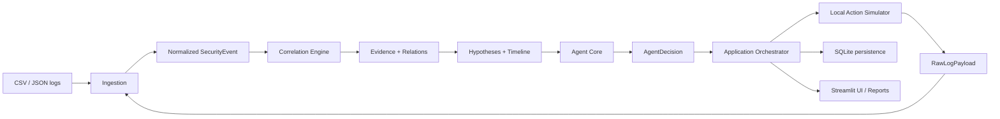

# TraceMind Team Onboarding

Welcome to TraceMind. Use this page as the short guided tour for new team members.

## Read in this order

1. [README](../README.md) — project goal, repository map, setup.
2. [Architecture](ARCHITECTURE.md) — system boundaries and end-to-end flow.
3. [Domain Model](DOMAIN_MODEL.md) — shared entities and service contracts.
4. [Data Model](DATA_MODEL.md) — SQLite persistence design.
5. Your module's design document:
   - [Agent Design](AGENT_DESIGN.md)
   - [Correlation Engine](CORRELATION_ENGINE.md)
6. [Team Workflow](TEAM_WORKFLOW.md) — ownership, branches, contracts, PRs.
7. [Implementation Plan](IMPLEMENTATION_PLAN.md) — sequence, milestones, acceptance criteria.
8. [Test Strategy](TEST_STRATEGY.md) — required tests and scenarios.

## The system in one flow

## Key invariants

- Domain models and contracts are shared; do not invent local alternatives.
- Agent selects an action; application orchestration dispatches it.
- The simulator returns typed results and simulated log payloads.
- Simulated payloads must pass through ingestion before becoming normalized events.
- Correlation means association, not causation.
- Heuristic confidence is not a calibrated probability.
- UI consumes application services; it does not implement business logic.
- New behavior requires tests and, when relevant, documentation updates.

## Ownership at a glance

| Member | Main responsibility |
|---|---|
| M1 | Ingestion and SQLite persistence |
| M2 | Evidence correlation and graph |
| M3 | Agent reasoning and utility scoring |
| M4 | Hypothesis evaluation and timeline |
| M5 | Streamlit UI and reporting |
| M6 | Shared contracts, orchestration, integration and E2E |

The detailed assignment and dependency rules in [TEAM_WORKFLOW.md](TEAM_WORKFLOW.md) are authoritative.

## Before opening a PR

- Confirm your change belongs to your assigned module.
- Check the working tree and inspect existing changes.
- Add/update focused tests.
- Run relevant tests; report anything not run.
- Inspect `git diff`.
- Update documentation when interfaces, behavior, database schema, or architecture changes.
- Explain risks and compatibility implications in the PR.
