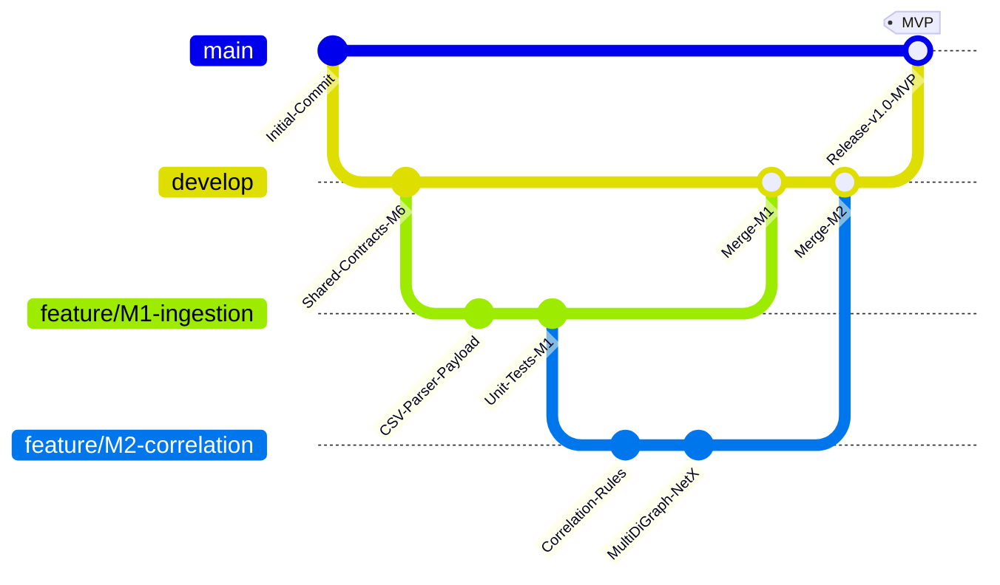
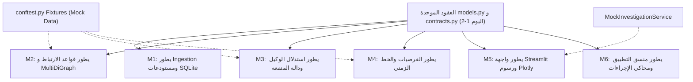

# TraceMind — وثيقة سير عمل الفريق والتطوير المتوازي (Team Workflow & Parallel Strategy)

[العودة إلى المعمارية الرئيسية (Main Architecture)](ARCHITECTURE.md)

---

## 1. استراتيجية إدارة الشيفرة والفروع (Git Branching Strategy)

يعتمد الفريق استراتيجية **Trunk-Based / Feature-Branch Flow** منظمة لتفادي تضاربات الدمج وضمان استقرار المستودع:

### 1.1 تسمية الفروع (Branch Naming Convention)
- الفروع الرئيسية المحمية: `main` (الإنتاجية المستقرة فقط)، و `develop` (فرع التكامل المشترك).
- فروع الميزات لكل عضو:
  - `feature/M1-ingestion-parsers`
  - `feature/M1-sqlite-repositories`
  - `feature/M2-correlation-rules`
  - `feature/M3-agent-utility-engine`
  - `feature/M4-hypothesis-lifecycle`
  - `feature/M5-streamlit-timeline-page`
  - `feature/M6-orchestrator-integration`
- فروع الإصلاحات السريعة: `hotfix/M{number}-issue-description`

---

## 2. معايير طلبات الدمج (Pull Request Rules & Definition of Done)

### 2.1 شروط قبول طلب الدمج (PR Acceptance Criteria)
1. **الحجم المنضبط:** لا يتجاوز طلب الدمج الواحد 400 سطر تغيير لتسهيل المراجعة الدقيقة.
2. **المراجعة المزدوجة الإلزامية:**
   - موافقة **Member 6 (Integration Lead)** للتأكد من عدم انتهاك العقود المشتركة.
   - موافقة **عضو الحزمة المجاورة المستهلكة** (مثلاً: PR الخاص بـ Member 1 يُراجعه Member 2).
3. **نجاح الاختبارات الآلية:** اجتياز كافة اختبارات `pytest` بنجاح دون أي فشل.

### 2.2 مصفوفة التعريف بالإنجاز (Definition of Done - DoD)
- [ ] الكود موثق بـ Docstrings واضحة تصف المدخلات والمخرجات.
- [ ] وجود اختبارات وحدة (Unit Tests) تغطي الحالات الطبيعية والاستثنائية بنسبة $\ge 80\%$.
- [ ] عدم وجود أي استدعاء مباشر لقاعدة البيانات أو المنطق الداخلي من داخل ملفات واجهة Streamlit.
- [ ] توافق الأنواع الكامل (`Type Hints`) مع النماذج المجالية والكائنات المعرفة في `app/domain/models.py`.

---

## 3. حوكمة تعديل العقود المشتركة (Interface Change Governance)

تعتبر حزمة `app/domain/` هي الأساس المشترك للمشروع؛ لذا يُطبق عليها نظام حوكمة صارم:
- **المالك المسؤول:** Member 6 هو المسؤول الوحيد عن تعديل `models.py` و `contracts.py`.
- **مسار طلب التغيير (RFC Process):**
  1. إذا احتاج أي مطور إضافة حقل في كائن ما، يفتح تذكرة Issue تسمى: `RFC: Add field X to Model Y`.
  2. يُشترط نقاش التغيير وموافقة العضوين المعنيين (المنتج والمستهلك للحقل).
  3. يقوم Member 6 بتحديث النموذج والـ Mocks المقابلة في `conftest.py` وإشعار الفريق بالتحديث فوراً.

---

## 4. مصفوفة مسؤوليات المطورين الستة (Ownership Matrix)

تمت إعادة موازنة المهام لتوزيع العبء بالتساوي وتفادي اختناق Member 6:

| المطور | النطاق المملوك حصرياً | مسؤولية اختبارات الوحدة الخاصة به | الاعتمادات المطلوبة | المخرجات المقدمة للفريق |
| :---: | :--- | :--- | :--- | :--- |
| **Member 1** | `app/ingestion/` `app/infrastructure/` | - اختبارات CSV/JSON Parsers واستيعاب `RawLogPayload`. - اختبارات التطبيع وكشف التكرار. - اختبارات مستودعات SQLite مع التحقق من قيد `uq_selected_candidate_per_decision`. | ملفات السجلات وحمولات المحاكاة | كائنات `SecurityEvent` موحدة، وتنفيذ `IInvestigationRepository` |
| **Member 2** | `app/correlation/` | - اختبارات قواعد الارتباط الخمسة كل على حدة. - اختبار بناء حواف `nx.MultiDiGraph` المتعددة. - اختبار دالة إعداد بيانات الرسم `GraphVisualData`. | كائنات `SecurityEvent` من M1 | كائنات `Evidence`، علاقات `EvidenceRelation`، و `GraphVisualData` |
| **Member 3** | `app/agent/` | - اختبارات مصفوفة توليد الإجراءات. - اختبارات حساب دالة المنفعة $U(a) = B - C - R$. - اختبارات ضبط `is_selected = True` وصياغة التفسير. | الحالة المجردة من عقود M6 | كائنات `AgentDecision` مفسرة وخالية من أي تنفيذ |
| **Member 4** | `app/investigation/` | - اختبارات معادلة الثقة الاستدلالية. - اختبارات الفرضيات المتعارضة والناقصة. - اختبارات فرز وترتيب الخط الزمني. | الأدلة من M2 وقرارات الوكيل من M3 | كائنات `Hypothesis` المحدثة، وسجل `TimelineEntry` |
| **Member 5** | `app/ui/` `app/reporting/` | - اختبارات عزل الصفحات البرمجية. - اختبارات استهلاك الـ DTOs النمطية. - اختبارات سلامة تصدير التقارير. | واجهة `IInvestigationService` فقط | واجهة Streamlit تفاعلية، رسوم Plotly، وتصدير التقارير |
| **Member 6** | `app/domain/` `app/application/` `tests/` | - بنية `conftest.py` والمشتركات. - اختبارات التكامل الثنائية (Pipelines) وتنسيق `ActionExecutionResponse`. - اختبارات السيناريوهات الشاملة (E2E). | تنفيذات جميع الأعضاء | العقود المعتمدة (`Protocols`)، المنسق `Orchestrator`، والتحقق النهائي |

---

## 5. استراتيجية التطوير المتوازي عبر الـ Mocks (Mock Strategy)

تضمن هذه الاستراتيجية انطلاق عمل المطورين الستة في نفس اليوم دون أن ينتظر أحد اكتمال عمل زميله:

### أمثلة الـ Mocks المعتمدة:
1. **تطوير واجهة المستخدم (Member 5):**
   يقوم Member 5 بإنشاء `MockInvestigationService` تُرجع بيانات مجهزة وثابتة لكائنات `InvestigationSummary` و `GraphVisualData` و `TimelineEntry`، مما يتيح له تصميم واجهات Streamlit واختبارها وتنسيق رسوم Plotly من الأسبوع الأول دون الحاجة لانتظار محرك الوكيل أو قواعد الارتباط.
2. **تطوير الوكيل الذكي (Member 3):**
   يعتمد Member 3 على Fixture وهمي `mock_investigation_state` يحتوي على 3 أدلة وفرضية واحدة، ويقوم باختبار وتطوير خوارزمية المنفعة وتوليد الإجراءات والتفسيرات دون الحاجة لقراءة أي ملف حقيقي.
3. **تطوير محرك الارتباط (Member 2):**
   يعتمد Member 2 على قائمة أحداث مصنعة `sample_brute_force_events` للتحقق من أن قاعدة `SAME_ACCOUNT` تنتج حافة صحيحة بوزن 0.95.

[العودة إلى المعمارية الرئيسية (Main Architecture)](ARCHITECTURE.md)
