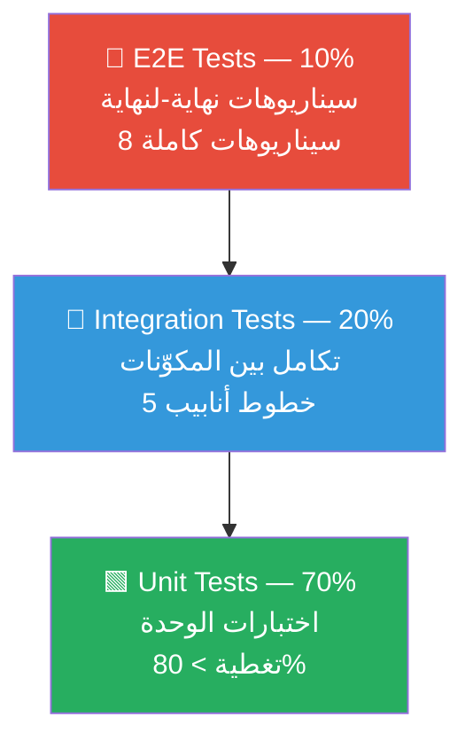

# TEST_STRATEGY.md — استراتيجية الاختبار في TraceMind

> وثيقة شاملة تصف منهجية اختبار نظام TraceMind على ثلاثة مستويات، مع تعريف سيناريوهات E2E وآليات قياس الجودة

---

## 1. هرم الاختبار ذو المستويات الثلاثة (Three-Level Testing Pyramid)



| المستوى | النسبة | الهدف | السرعة | الاعتمادية |
|---------|-------|-------|-------|-----------|
| **Unit** | 70% | اختبار كل وحدة عزلاً | < 1ms / اختبار | عالية جداً |
| **Integration** | 20% | اختبار تكامل المكوّنات | < 100ms / اختبار | عالية |
| **E2E** | 10% | التحقق من السيناريوهات الكاملة | < 5s / سيناريو | متوسطة |

---

## 2. تغطية اختبارات الوحدة بحسب الوحدة (Unit Test Coverage by Module)

### 2.1 وحدة `ingestion`

**التغطية المستهدفة: > 85%**

| الوظيفة المختبَرة | اسم الاختبار | ما يختبره |
|----------------|------------|---------|
| `CSVParser.parse()` | `test_csv_valid_row_parsed_correctly` | صف CSV صالح يُنتج `SecurityEvent` صحيح |
| `CSVParser.parse()` | `test_csv_missing_required_field_raises_error` | حقل إلزامي ناقص يُطلق `IngestionError` |
| `JSONParser.parse()` | `test_json_valid_event_parsed` | JSON صالح → `SecurityEvent` |
| `JSONParser.parse()` | `test_json_malformed_raises_error` | JSON مشوَّه → `JSONDecodeError` |
| `EventValidator.validate()` | `test_event_type_unknown_raises_validation_error` | نوع حدث غير معروف يُرفض |
| `EventValidator.validate()` | `test_severity_out_of_range_rejected` | `severity > 10` يُرفض |
| `EventNormalizer.normalize()` | `test_timestamp_converted_to_utc` | توحيد المنطقة الزمنية لـ UTC |
| `EventNormalizer.normalize()` | `test_ip_format_normalized` | توحيد صيغة عناوين IPv4/IPv6 |
| `DeduplicationFilter.is_duplicate()` | `test_exact_duplicate_detected` | حدثان متطابقان → المُكرَّر مرفوض |
| `DeduplicationFilter.is_duplicate()` | `test_similar_but_different_timestamps_not_dup` | نفس المحتوى ولكن وقت مختلف → ليس مُكرَّراً |

```python
# مثال على اختبار الوحدة للـ ingestion
class TestCSVParser:
    def test_csv_valid_row_parsed_correctly(self):
        raw = "evt_001,LOGIN_FAILURE,2024-01-15T10:00:00Z,alice,WS-001,192.168.1.1,,5,{}"
        event = CSVParser().parse_row(raw)
        
        assert event.event_id == "evt_001"
        assert event.event_type == EventType.LOGIN_FAILURE
        assert event.account_id == "alice"
        assert event.severity == 5

    def test_csv_missing_required_field_raises_error(self):
        raw = "evt_001,,2024-01-15T10:00:00Z"  # event_type ناقص
        with pytest.raises(IngestionError, match="event_type"):
            CSVParser().parse_row(raw)
```

### 2.2 وحدة `correlation`

**التغطية المستهدفة: > 90%** (مكوّن حرج)

| الوظيفة المختبَرة | اسم الاختبار | ما يختبره |
|----------------|------------|---------|
| `SAME_ACCOUNT rule` | `test_same_account_rule_triggers` | حدثان بنفس `account_id` → علاقة بوزن 0.9 |
| `SAME_ACCOUNT rule` | `test_different_accounts_no_relation` | حسابان مختلفان → لا علاقة |
| `SAME_DEVICE rule` | `test_same_device_rule_triggers` | نفس `device_id` → وزن 0.85 |
| `TEMPORAL_WINDOW rule` | `test_within_window_relation_created` | `Δt < threshold` → علاقة زمنية |
| `TEMPORAL_WINDOW rule` | `test_weight_decreases_with_delta_t` | وزن الحرف ينخفض كلما زاد `Δt` |
| `TEMPORAL_WINDOW rule` | `test_outside_window_no_relation` | `Δt > threshold` → لا علاقة |
| `NETWORK_PAIR rule` | `test_source_dest_pair_detected` | مصدر الحدث 1 = وجهة الحدث 2 → علاقة شبكية |
| `SAME_INDICATOR rule` | `test_same_ip_across_events_detected` | نفس IP في حدثَين → `SAME_INDICATOR` |
| `Graph construction` | `test_graph_nodes_count_matches_events` | عدد العقد = عدد الأحداث |
| `Graph construction` | `test_graph_edges_correctly_attributed` | سمات الأحرف صحيحة |
| `Cluster detection` | `test_isolated_event_forms_single_cluster` | حدث بلا علاقات → تجمع منفرد مرفوض |
| `Cluster score` | `test_high_weight_cluster_passes_threshold` | تجمع ذو وزون عالية يتجاوز الحد |

```python
class TestTemporalWindowRule:
    @pytest.fixture
    def base_event(self):
        return SecurityEventFactory.build(
            event_id="e1",
            timestamp=datetime(2024, 1, 15, 10, 0, 0, tzinfo=UTC),
        )

    def test_weight_decreases_with_delta_t(self, base_event):
        threshold = 3600.0
        deltas_and_expected = [(0, 1.0), (1800, 0.5), (3600, 0.0)]
        
        for delta, expected_weight in deltas_and_expected:
            e2 = SecurityEventFactory.build(
                timestamp=base_event.timestamp + timedelta(seconds=delta)
            )
            relation = apply_temporal_rule(base_event, e2, threshold)
            if delta < threshold:
                assert abs(relation.weight - expected_weight) < 0.01
            else:
                assert relation is None
```

### 2.3 وحدة `investigation`

**التغطية المستهدفة: > 85%**

| الوظيفة المختبَرة | اسم الاختبار | ما يختبره |
|----------------|------------|---------|
| `Hypothesis lifecycle` | `test_hypothesis_starts_as_open` | فرضية جديدة حالتها `OPEN` |
| `Hypothesis lifecycle` | `test_supporting_evidence_increases_confidence` | دليل داعم يرفع الثقة |
| `Hypothesis lifecycle` | `test_contradicting_evidence_decreases_confidence` | دليل معارض يخفض الثقة |
| `Hypothesis lifecycle` | `test_high_confidence_transitions_to_confirmed` | ثقة ≥ 0.8 → `CONFIRMED` |
| `Hypothesis lifecycle` | `test_low_confidence_transitions_to_rejected` | ثقة ≤ 0.2 → `REJECTED` |
| `Confidence update` | `test_confidence_clamped_between_0_and_1` | الثقة لا تخرج عن `[0.0, 1.0]` |
| `Timeline ordering` | `test_events_sorted_by_timestamp_ascending` | الأحداث مُرتَّبة زمنياً |
| `Timeline ordering` | `test_simultaneous_events_stable_sort` | أحداث متزامنة ترتيب مستقر |
| `Missing info detection` | `test_gap_in_timeline_added_to_missing` | فجوة زمنية تُضاف لـ `missing_information` |

### 2.4 وحدة `agent`

**التغطية المستهدفة: > 85%**

| الوظيفة المختبَرة | اسم الاختبار | ما يختبره |
|----------------|------------|---------|
| `Utility calculation` | `test_high_info_gain_increases_utility` | كسب معلوماتي عالٍ → منفعة مرتفعة |
| `Utility calculation` | `test_high_cost_decreases_utility` | تكلفة عالية → منفعة منخفضة |
| `Utility calculation` | `test_high_risk_decreases_utility` | خطر عالٍ → منفعة منخفضة |
| `Action selection` | `test_highest_utility_action_selected` | الإجراء ذو أعلى منفعة يُختار |
| `Action selection` | `test_tie_broken_by_action_priority` | تعادل المنفعة → الأولوية تكسر التعادل |
| `Explanation generation` | `test_explanation_contains_evidence_ids` | الشرح يتضمن معرّفات الأدلة |
| `Explanation generation` | `test_explanation_contains_hypothesis_id` | الشرح يتضمن معرّف الفرضية |
| `Stopping conditions` | `test_all_hypotheses_concluded_stops_agent` | كل الفرضيات محسومة → الوكيل يتوقف |
| `Stopping conditions` | `test_max_steps_reached_stops_agent` | الحد الأقصى للخطوات → إيقاف |

### 2.5 وحدة `reporting`

**التغطية المستهدفة: > 80%**

| الوظيفة المختبَرة | اسم الاختبار | ما يختبره |
|----------------|------------|---------|
| `Report structure` | `test_report_has_required_sections` | التقرير يحتوي كل الأقسام المطلوبة |
| `Report structure` | `test_report_hypothesis_count_matches` | عدد الفرضيات في التقرير صحيح |
| `Report structure` | `test_report_evidence_count_matches` | عدد الأدلة في التقرير صحيح |
| `Report serialization` | `test_report_serializes_to_valid_json` | التقرير يُسلسَل لـ JSON صالح |
| `Report serialization` | `test_report_markdown_export_valid` | تصدير Markdown صحيح |

---

## 3. سيناريوهات اختبارات التكامل (Integration Test Scenarios)

### 3.1 خط أنابيب الاستيعاب → الارتباط (Ingestion → Correlation)

```python
class TestIngestionCorrelationPipeline:
    def test_csv_events_produce_same_account_relations(self, tmp_path):
        """أحداث CSV تُستوعب وتُولِّد علاقات SAME_ACCOUNT في المحرّك."""
        csv_file = tmp_path / "events.csv"
        csv_file.write_text(SAMPLE_CSV_WITH_SAME_ACCOUNT)
        
        events = CSVIngestionService().ingest(str(csv_file))
        result = CorrelationEngine().correlate(events)
        
        same_account_edges = [
            e for e in result.relations
            if e.relation_type == RelationType.SAME_ACCOUNT
        ]
        assert len(same_account_edges) > 0
        assert result.summary.total_relations_found > 0
```

### 3.2 خط أنابيب الارتباط → التحقيق (Correlation → Investigation)

```python
def test_correlated_evidence_updates_hypothesis_confidence():
    """الأدلة المُرتبطة تُحدِّث ثقة الفرضيات في خدمة التحقيق."""
    events = SecurityEventFactory.build_batch(5, account_id="alice")
    correlation_result = CorrelationEngine().correlate(events)
    
    investigation = InvestigationService().create_investigation(
        events=events,
        initial_hypotheses=[HypothesisFactory.brute_force()]
    )
    investigation_service.apply_evidence(
        investigation.id, correlation_result.evidence
    )
    
    updated_state = investigation_service.get_state(investigation.id)
    brute_force_hyp = next(
        h for h in updated_state.hypotheses
        if h.hypothesis_type == HypothesisType.BRUTE_FORCE
    )
    assert brute_force_hyp.confidence > 0.0  # الثقة ارتفعت
```

### 3.3 خط أنابيب التحقيق → دورة الوكيل (Investigation → Agent Cycle)

```python
def test_agent_cycle_progresses_investigation():
    """دورة كاملة للوكيل تُقدِّم التحقيق خطوة واحدة على الأقل."""
    state = InvestigationStateFactory.build_with_open_hypotheses()
    
    initial_step = state.step_count
    agent_service = AgentService(config=TestAgentConfig())
    decision = agent_service.run_single_step(state)
    
    assert decision is not None
    assert decision.action_type in ActionType
    assert state.step_count == initial_step + 1
```

### 3.4 دورة الوكيل → التخزين والاسترجاع (Agent → Storage Round-trip)

```python
def test_agent_decision_persisted_and_retrieved(db_session):
    """قرار الوكيل يُحفظ في قاعدة البيانات ويُسترجع بشكل صحيح."""
    decision = AgentDecisionFactory.build()
    storage_service = StorageService(session=db_session)
    
    saved_id = storage_service.save_decision(decision)
    retrieved = storage_service.get_decision(saved_id)
    
    assert retrieved.action_type == decision.action_type
    assert retrieved.utility_score == pytest.approx(decision.utility_score, abs=1e-6)
    assert retrieved.explanation == decision.explanation
```

### 3.5 طبقة الخدمة → عقود بيانات Dashboard

```python
def test_dashboard_data_contract_valid(investigation_service, correlation_engine):
    """البيانات المُرسَلة للـ Dashboard تتوافق مع العقد المتفق عليه."""
    state = investigation_service.get_current_state()
    dashboard_data = DashboardDataService().build_dashboard_data(state)
    
    # التحقق من العقد
    assert "investigation_id" in dashboard_data
    assert "hypothesis_summary" in dashboard_data
    assert "evidence_count" in dashboard_data
    assert "agent_step_count" in dashboard_data
    assert isinstance(dashboard_data["hypothesis_summary"], list)
```

---

## 4. سيناريوهات اختبارات E2E (End-to-End Test Scenarios)

### 4.1 السيناريو 1: الحالة الطبيعية (لا نشاط مشبوه)

| العنصر | التفاصيل |
|------|---------|
| **الوصف** | أحداث عادية: تسجيل دخول ناجح، وصول طبيعي للبيانات، بدون أنماط مشبوهة |
| **الأحداث المُدخَلة** | 3 أحداث `LOGIN_SUCCESS`، 2 أحداث `DATA_ACCESS` عادية، `severity ≤ 3` |
| **المخرج المتوقع** | كل الفرضيات مرفوضة، تقرير "لا تهديد" |
| **شروط النجاح** | `all(h.status == REJECTED for h in hypotheses)` |
| **الإجراء المتوقع** | `CONCLUDE_INVESTIGATION` بعد ≤ 5 خطوات |

### 4.2 السيناريو 2: هجوم بالقوة الغاشمة + تسجيل دخول ناجح (مشبوه)

| العنصر | التفاصيل |
|------|---------|
| **الوصف** | 10 محاولات تسجيل دخول فاشلة متتالية خلال 3 دقائق، ثم دخول ناجح |
| **الأحداث المُدخَلة** | 10 أحداث `LOGIN_FAILURE` + 1 حدث `LOGIN_SUCCESS` (نفس الحساب، نفس IP) |
| **المخرج المتوقع** | فرضية `BRUTE_FORCE_ATTACK` بثقة > 0.8، تصعيد للمراجعة البشرية |
| **شروط النجاح** | `ESCALATE_FOR_HUMAN_REVIEW` يُنفَّذ، فرضية البروت فورس `CONFIRMED` |
| **الأحداث الارتباطية** | علاقات `SAME_ACCOUNT` + `TEMPORAL_WINDOW` (300 ثانية) + `SAME_INDICATOR` |

### 4.3 السيناريو 3: أدلة ناقصة

| العنصر | التفاصيل |
|------|---------|
| **الوصف** | أدلة جزئية تُلمِّح لتهديد لكن سجلات شبكية مفقودة |
| **الأحداث المُدخَلة** | 2 أحداث `LOGIN_FAILURE` + 1 حدث `ANOMALOUS_TRAFFIC` بدون سجلات نشاط جهاز |
| **المخرج المتوقع** | `missing_information` غير فارغة، تُولِّد `REQUEST_ADDITIONAL_LOGS` |
| **شروط النجاح** | الوكيل يطلب سجلات إضافية قبل الوصول لاستنتاج |
| **التوقف المتوقع** | لا إنهاء حتى وصول بيانات إضافية (محاكاة) |

### 4.4 السيناريو 4: أدلة متعارضة

| العنصر | التفاصيل |
|------|---------|
| **الوصف** | دليل يدعم الفرضية ودليل آخر يعارضها في نفس الوقت |
| **الأحداث المُدخَلة** | `LOGIN_SUCCESS` من IP موثوق + `DATA_EXFILTRATION` لنفس الحساب |
| **المخرج المتوقع** | `contradicting_evidence` غير فارغة، `REVIEW_EVIDENCE_RELATION` يُنفَّذ |
| **شروط النجاح** | الوكيل يُراجع التعارض قبل الوصول لاستنتاج |
| **حالة الفرضية** | تبقى `SUPPORTED` أو تُرفَع للمراجعة البشرية |

### 4.5 السيناريو 5: بيانات مشوَّهة / غير صالحة

| العنصر | التفاصيل |
|------|---------|
| **الوصف** | ملف CSV يحتوي صفوفاً بتنسيق خاطئ أو حقول ناقصة |
| **الأحداث المُدخَلة** | ملف CSV مختلط: 3 صفوف صالحة + 2 صفوف مشوَّهة |
| **المخرج المتوقع** | 3 أحداث تُستوعب، 2 أحداث تُرفض مع تسجيل خطأ، لا انهيار |
| **شروط النجاح** | لا استثناء غير مُعالَج، `IngestionError` مُسجَّل في dead queue |
| **التوقف المتوقع** | التحقيق يستمر بالبيانات الصالحة |

### 4.6 السيناريو 6: أحداث مُكرَّرة

| العنصر | التفاصيل |
|------|---------|
| **الوصف** | نفس الحدث يُرسَل مرتين (نتيجة إعادة محاولة النظام) |
| **الأحداث المُدخَلة** | حدث `LOGIN_FAILURE` مُكرَّر مرتين بنفس `event_id` |
| **المخرج المتوقع** | حدث واحد فقط في الرسم البياني، لا أحرف مضاعفة |
| **شروط النجاح** | `graph.number_of_nodes() == 1`، لا تأثير على قيم الثقة |
| **الآلية** | `DeduplicationFilter` يكتشف التكرار بـ `event_id` |

### 4.7 السيناريو 7: فشل إجراء محاكَى

| العنصر | التفاصيل |
|------|---------|
| **الوصف** | إجراء `REQUEST_ADDITIONAL_LOGS` يُنفَّذ لكن المحاكاة تُعيد فشلاً |
| **الأحداث المُدخَلة** | حالة تحقيق بـ `missing_information` وإعداد mock يُعيد `ActionFailure` |
| **المخرج المتوقع** | الوكيل يُسجِّل الفشل ويختار إجراءً بديلاً من الإجراءات المرشحة |
| **شروط النجاح** | لا توقف الوكيل، الدورة تستمر، الفشل موثَّق في `decision.feedback` |
| **الإجراء البديل** | `ANALYZE_RELATED_EVENT` أو `INVESTIGATE_ENTITY` |

### 4.8 السيناريو 8: إنهاء التحقيق بعد الحد الأقصى من الخطوات

| العنصر | التفاصيل |
|------|---------|
| **الوصف** | تحقيق يصل للحد الأقصى للخطوات دون التوصل لاستنتاج قاطع |
| **الأحداث المُدخَلة** | حالة تحقيق مُعقَّدة مع `MAX_AGENT_STEPS = 5` في الاختبار |
| **المخرج المتوقع** | إيقاف قسري، تقرير جزئي، تحذير `MAX_STEPS_REACHED` |
| **شروط النجاح** | `investigation.status == CONCLUDED_PARTIAL`، تقرير يحتوي تحذيراً |
| **الحالة النهائية** | الفرضيات في حالاتها الأخيرة قبل الإيقاف |

---

## 5. تعريف الحقيقة الأساسية (Ground Truth Definition)

### 5.1 كيفية تعريف Ground Truth للسيناريوهات الاصطناعية

```python
@dataclass
class ScenarioGroundTruth:
    """يُعرِّف النتائج المتوقعة لسيناريو اختبار محدد."""
    scenario_id: str
    
    # نتائج الارتباط المتوقعة
    expected_relations: list[ExpectedRelation]  # الأحرف المتوقعة في الرسم
    expected_clusters: int                       # عدد التجمعات المتوقع
    
    # نتائج الفرضيات المتوقعة
    expected_hypothesis_statuses: dict[str, HypothesisStatus]
    expected_final_confidences: dict[str, tuple[float, float]]  # (min, max)
    
    # نتائج الوكيل المتوقعة
    expected_final_action: ActionType
    max_expected_steps: int
    expected_action_sequence: list[ActionType] | None  # None إذا لم يكن ترتيباً صارماً
    
    # نتائج التقرير المتوقعة
    expected_threat_level: ThreatLevel
    expected_conclusion: str  # الاستنتاج النصي الجوهري
```

### 5.2 المخرجات المتوقعة لكل سيناريو

| السيناريو | حالة الفرضيات المتوقعة | الإجراء النهائي | مستوى التهديد |
|---------|---------------------|----------------|--------------|
| 1 — طبيعي | جميعها `REJECTED` | `CONCLUDE_INVESTIGATION` | `NONE` |
| 2 — Brute Force | `BRUTE_FORCE: CONFIRMED` | `ESCALATE_FOR_HUMAN_REVIEW` | `HIGH` |
| 3 — أدلة ناقصة | الفرضيات في `OPEN` | `REQUEST_ADDITIONAL_LOGS` | `UNKNOWN` |
| 4 — أدلة متعارضة | فرضية في `SUPPORTED` مع تعارض | `REVIEW_EVIDENCE_RELATION` | `MEDIUM` |
| 5 — بيانات مشوَّهة | فرضيات بناءً على البيانات الصالحة فقط | يتباين | يتباين |
| 6 — أحداث مُكرَّرة | مثل السيناريو الأصلي بلا تكرار | يتباين | يتباين |
| 7 — فشل الإجراء | تستمر رغم الفشل | إجراء بديل | يتباين |
| 8 — الحد الأقصى | حالات غير محسومة | إيقاف قسري | `PARTIAL` |

---

## 6. مقاييس التقييم (Evaluation Metrics)

### 6.1 مقاييس الارتباط

$$\text{Precision} = \frac{|E_{\text{predicted}} \cap E_{\text{expected}}|}{|E_{\text{predicted}}|}$$

$$\text{Recall} = \frac{|E_{\text{predicted}} \cap E_{\text{expected}}|}{|E_{\text{expected}}|}$$

$$F_1 = 2 \cdot \frac{\text{Precision} \cdot \text{Recall}}{\text{Precision} + \text{Recall}}$$

| المقياس | الحد الأدنى المطلوب | الهدف |
|--------|------------------|-------|
| Precision على الأحرف | ≥ 0.85 | ≥ 0.95 |
| Recall على الأحرف | ≥ 0.80 | ≥ 0.90 |
| F1-score | ≥ 0.83 | ≥ 0.92 |

### 6.2 مقاييس الوكيل

| المقياس | الحد الأدنى | الحساب |
|--------|-----------|-------|
| **معدل اختيار الإجراء الصحيح** | ≥ 80% | `(صح / الكل) * 100` |
| **متوسط الخطوات للاستنتاج** | ≤ 20 خطوة | متوسط على السيناريوهات القابلة للإنهاء |
| **معدل التصعيد الخاطئ** | ≤ 5% | `(تصعيد غير مبرر / كل التصعيدات) * 100` |
| **معدل فوات الاستنتاج** | ≤ 10% | `(إنهاء خاطئ / كل الإنهاءات) * 100` |

### 6.3 مقاييس الفرضيات

| المقياس | الوصف | الهدف |
|--------|-------|-------|
| **معدل المعالجة الصحيحة للداعم** | الأدلة الداعمة ترفع الثقة | ≥ 95% |
| **معدل المعالجة الصحيحة للمعارض** | الأدلة المعارضة تخفض الثقة | ≥ 95% |
| **معدل اكتشاف التعارض** | التعارضات تُكتشف وتُعالَج | ≥ 90% |
| **دقة التصنيف النهائي** | الحالة النهائية صحيحة مقارنة بـ Ground Truth | ≥ 85% |

### 6.4 مقاييس النظام

| المقياس | الحد الأقصى / الهدف |
|--------|------------------|
| **وقت معالجة 100 حدث** | < 2 ثانية |
| **وقت دورة كاملة للوكيل (10 خطوات)** | < 30 ثانية |
| **معدل الخطأ في الاختبارات** | < 1% |
| **تغطية الكود (Code Coverage)** | > 80% |
| **ذاكرة ذروة في E2E** | < 512 MB |

---

## 7. البنية التحتية للاختبار (Test Infrastructure)

### 7.1 تهيئة pytest

```ini
# pytest.ini
[pytest]
testpaths = tests
python_files = test_*.py
python_classes = Test*
python_functions = test_*
addopts =
    --strict-markers
    --tb=short
    -q
    --cov=tracemind
    --cov-report=term-missing
    --cov-fail-under=80

markers =
    unit: اختبارات الوحدة المعزولة
    integration: اختبارات التكامل بين المكوّنات
    e2e: اختبارات نهاية-لنهاية
    slow: اختبارات بطيئة تُستبعَد من CI الافتراضي
```

### 7.2 المصانع والـ Fixtures

```python
# tests/factories.py
import factory
from factory import Factory, SubFactory

class SecurityEventFactory(Factory):
    """مصنع اصطناعي لإنشاء SecurityEvent في الاختبارات."""
    class Meta:
        model = SecurityEvent

    event_id = factory.Sequence(lambda n: f"evt_{n:04d}")
    event_type = EventType.LOGIN_FAILURE
    timestamp = factory.LazyFunction(lambda: datetime.now(UTC))
    account_id = factory.Faker("user_name")
    device_id = factory.Sequence(lambda n: f"WS-{n:03d}")
    source_ip = factory.Faker("ipv4_private")
    dest_ip = None
    severity = factory.Faker("random_int", min=1, max=10)
    raw_data = factory.LazyFunction(dict)

class HypothesisFactory(Factory):
    class Meta:
        model = Hypothesis

    hypothesis_id = factory.LazyFunction(lambda: str(uuid4()))
    hypothesis_type = HypothesisType.BRUTE_FORCE
    status = HypothesisStatus.OPEN
    confidence = 0.5

    @classmethod
    def brute_force(cls) -> Hypothesis:
        return cls(hypothesis_type=HypothesisType.BRUTE_FORCE)
```

```python
# tests/conftest.py
import pytest
from sqlalchemy import create_engine
from sqlalchemy.orm import Session

@pytest.fixture(scope="function")
def db_session():
    """جلسة قاعدة بيانات في الذاكرة للاختبارات."""
    engine = create_engine("sqlite:///:memory:")
    Base.metadata.create_all(engine)
    with Session(engine) as session:
        yield session
        session.rollback()

@pytest.fixture
def sample_brute_force_events():
    """مجموعة أحداث محاكاة لهجوم Brute Force."""
    account = "alice"
    ip = "192.168.1.50"
    base_time = datetime(2024, 1, 15, 10, 0, 0, tzinfo=UTC)
    
    failures = [
        SecurityEventFactory.build(
            event_type=EventType.LOGIN_FAILURE,
            account_id=account,
            source_ip=ip,
            timestamp=base_time + timedelta(seconds=i * 20),
            severity=6,
        )
        for i in range(10)
    ]
    success = SecurityEventFactory.build(
        event_type=EventType.LOGIN_SUCCESS,
        account_id=account,
        source_ip=ip,
        timestamp=base_time + timedelta(seconds=220),
        severity=4,
    )
    return failures + [success]

@pytest.fixture
def agent_service():
    """خدمة الوكيل مُهيَّأة للاختبار بإعدادات محافظة."""
    config = AgentConfig(
        max_steps=10,
        min_utility_threshold=0.01,
        utility_weights=DEFAULT_TEST_WEIGHTS,
    )
    return AgentService(config=config)
```

### 7.3 استراتيجيات المحاكاة (Mock Strategies)

يستخدم TraceMind **Protocols** بدلاً من الفئات المجردة لتيسير المحاكاة:

```python
# tracemind/ports.py — واجهات Protocol قابلة للمحاكاة
from typing import Protocol

class EventStoragePort(Protocol):
    def save_events(self, events: list[SecurityEvent]) -> None: ...
    def get_events(self, investigation_id: str) -> list[SecurityEvent]: ...

class ActionExecutorPort(Protocol):
    def execute(self, decision: AgentDecision) -> ActionResult: ...

# tests/mocks.py — محاكيات للاختبار
class MockActionExecutor:
    """محاكي لـ ActionExecutor يُعيد نتائج مُسبقة التعريف."""
    def __init__(self, results: dict[ActionType, ActionResult]):
        self._results = results
        self.calls: list[AgentDecision] = []

    def execute(self, decision: AgentDecision) -> ActionResult:
        self.calls.append(decision)
        return self._results.get(decision.action_type, ActionResult.success())
```

```python
# مثال على استخدام Mock في اختبار التكامل
def test_failed_action_triggers_fallback(agent_service):
    """فشل الإجراء يُشغِّل إجراءً بديلاً."""
    failing_executor = MockActionExecutor({
        ActionType.REQUEST_ADDITIONAL_LOGS: ActionResult.failure("timeout"),
    })
    
    state = InvestigationStateFactory.with_missing_info()
    decision = agent_service.run_single_step(state, executor=failing_executor)
    
    # الإجراء الفاشل مُحاوَل
    assert any(c.action_type == ActionType.REQUEST_ADDITIONAL_LOGS for c in failing_executor.calls)
    # الدورة التالية تختار إجراءً مختلفاً
    next_decision = agent_service.run_single_step(state, executor=failing_executor)
    assert next_decision.action_type != ActionType.REQUEST_ADDITIONAL_LOGS
```

### 7.4 تشغيل الاختبارات بدون Streamlit

> [!IMPORTANT]
> يجب أن تكون **كل** وحدات الأعمال معزولة تماماً عن Streamlit. لا يجوز أي `import streamlit` خارج طبقة `dashboard/`.

```bash
# تشغيل اختبارات الوحدة فقط (سريع)
pytest tests/unit/ -m unit

# تشغيل اختبارات التكامل
pytest tests/integration/ -m integration

# تشغيل E2E (يتطلب إعداد البيئة)
pytest tests/e2e/ -m e2e

# تشغيل كامل مع تقرير التغطية
pytest --cov=tracemind --cov-report=html

# استبعاد الاختبارات البطيئة
pytest -m "not slow"

# تشغيل سيناريو محدد
pytest tests/e2e/test_scenarios.py::test_brute_force_scenario -v
```

```python
# tests/e2e/test_scenarios.py
# كل السيناريوهات تعمل بدون Streamlit — تختبر الطبقة الخدمية مباشرة

@pytest.mark.e2e
def test_brute_force_scenario(sample_brute_force_events, agent_service, db_session):
    """السيناريو 2: هجوم Brute Force يُكتشف ويُصعَّد."""
    # المرحلة 1: الاستيعاب
    ingestion_service = IngestionService()
    validated_events = ingestion_service.process(sample_brute_force_events)
    
    # المرحلة 2: الارتباط
    correlation_engine = CorrelationEngine()
    correlation_result = correlation_engine.correlate(validated_events)
    
    # التحقق من الارتباطات
    assert correlation_result.summary.total_relations_found >= 10
    
    # المرحلة 3: التحقيق
    investigation_service = InvestigationService(session=db_session)
    investigation = investigation_service.create(
        events=validated_events,
        evidence=correlation_result.evidence,
    )
    
    # المرحلة 4: دورات الوكيل
    final_state = agent_service.run_until_conclusion(investigation.id)
    
    # التحقق من المخرجات
    brute_force_hyp = next(
        h for h in final_state.hypotheses
        if h.hypothesis_type == HypothesisType.BRUTE_FORCE
    )
    assert brute_force_hyp.status == HypothesisStatus.CONFIRMED
    assert brute_force_hyp.confidence >= 0.8
    assert final_state.last_action.action_type == ActionType.ESCALATE_FOR_HUMAN_REVIEW
```

---

## ملحق: هيكل مجلد الاختبارات

```
tests/
├── conftest.py              # Fixtures مشتركة
├── factories.py             # مصانع البيانات الاصطناعية
├── mocks.py                 # محاكيات Protocol
├── fixtures/
│   ├── sample_events.csv    # بيانات CSV للاختبار
│   └── sample_events.json   # بيانات JSON للاختبار
├── unit/
│   ├── test_ingestion.py
│   ├── test_correlation.py
│   ├── test_investigation.py
│   ├── test_agent.py
│   └── test_reporting.py
├── integration/
│   ├── test_ingestion_correlation.py
│   ├── test_correlation_investigation.py
│   ├── test_investigation_agent.py
│   ├── test_agent_storage.py
│   └── test_service_dashboard.py
└── e2e/
    └── test_scenarios.py    # السيناريوهات الثمانية الكاملة
```

---

*آخر تحديث: 2026 — وثيقة حية تتطور مع تطوير الاختبارات*
